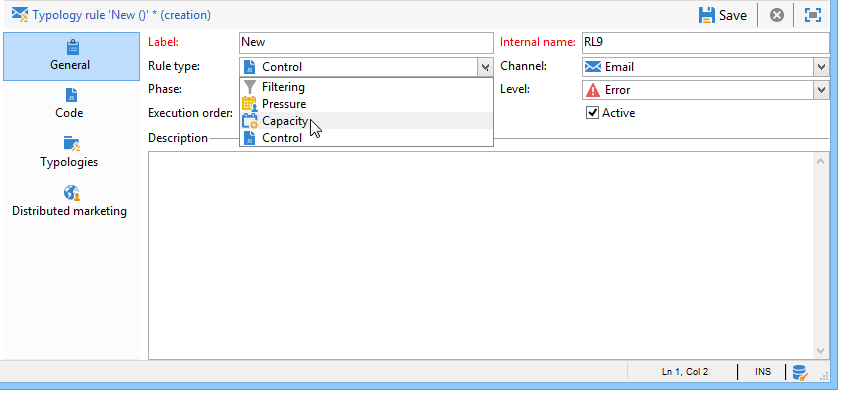
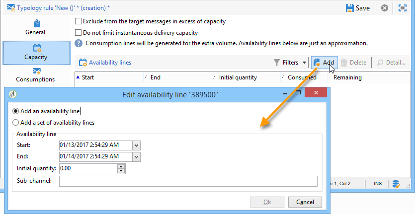
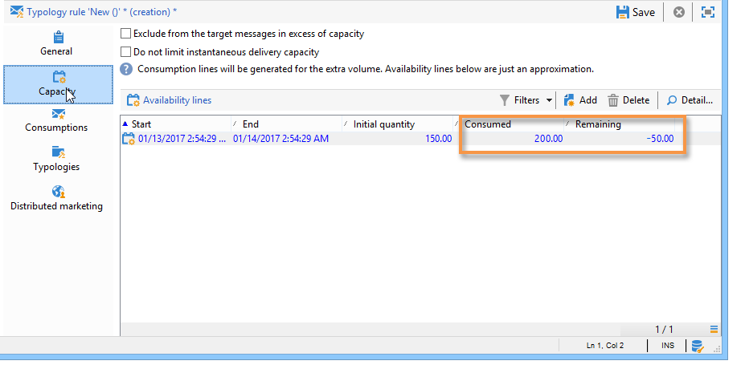
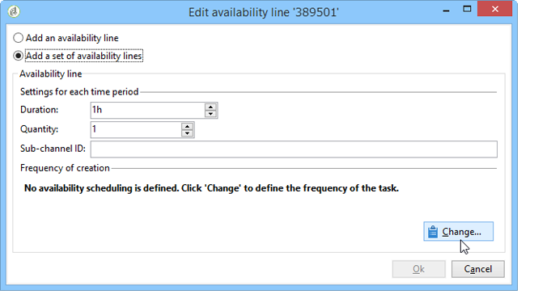
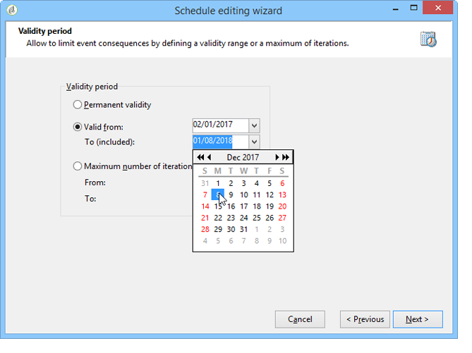
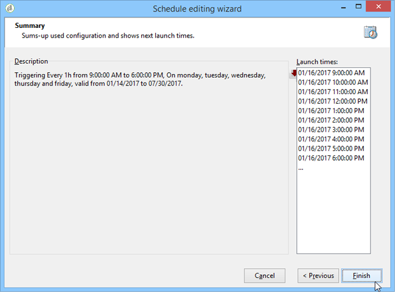
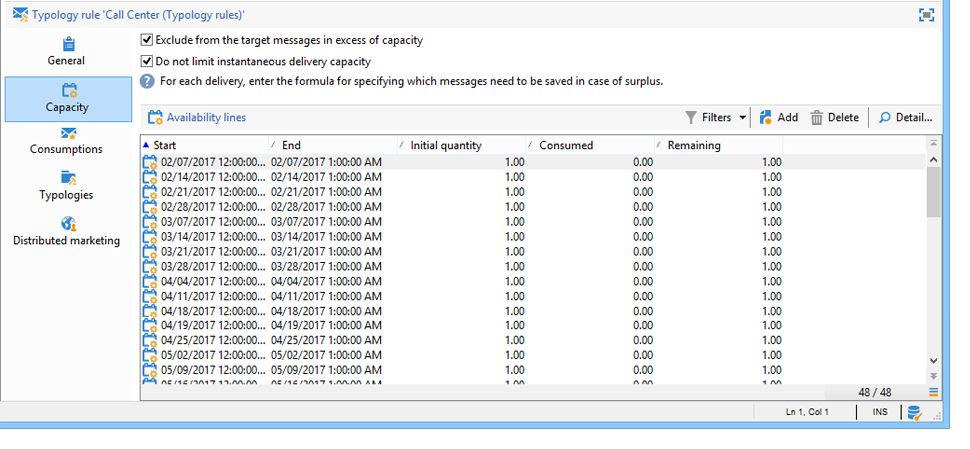
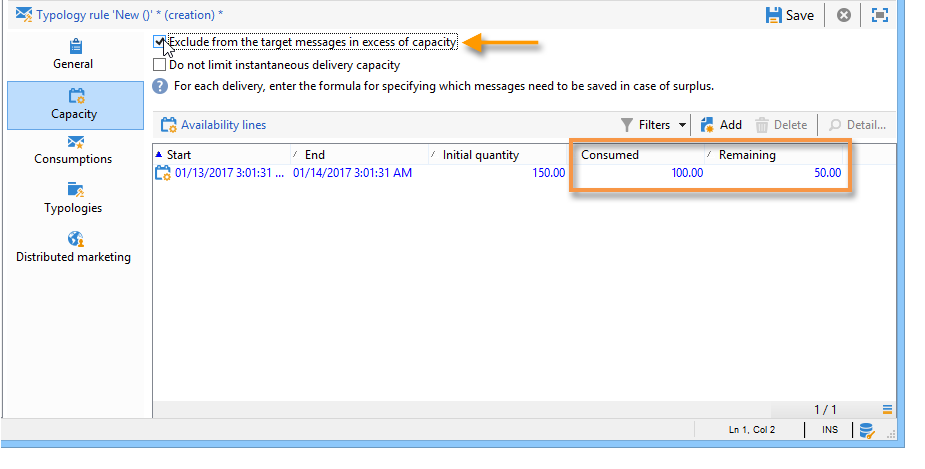
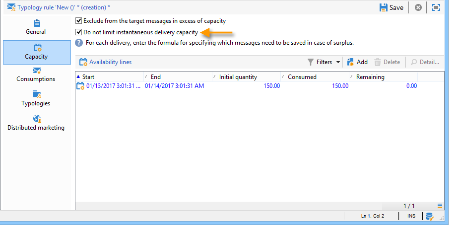
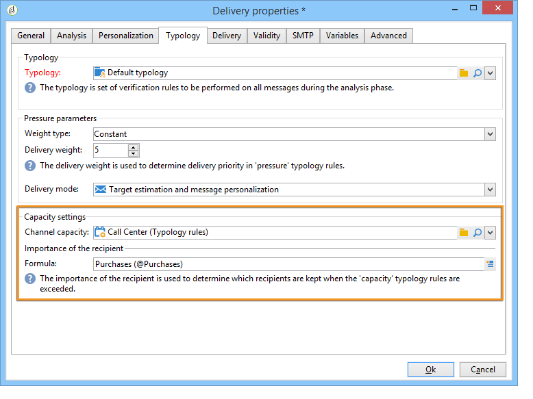

# Reglas de coherencia{#consistency-rules}

Adobe Campaign garantiza comunicaciones coherentes gracias a un conjunto de reglas contenidas en tipologías de campaña. Su objetivo es controlar las entregas que se realizan a los destinatarios como, por ejemplo, volumen, tipo, relevancia, etc.

Las reglas de **capacidad**, por ejemplo, pueden evitar la sobrecarga en la plataforma correspondiente de envío de mensajes. Por ejemplo, las ofertas especiales que contienen un vínculo de descarga no se deben enviar a demasiadas personas a la vez para evitar la saturación del servidor; las campañas telefónicas no deben superar la capacidad de procesamiento de los centros de llamadas, etc.

## Control de la capacidad {#control-capacity}

Antes de enviar mensajes, debe asegurarse de que su organización tiene la capacidad (infraestructura física) para procesar la entrega, las respuestas que puede generar la entrega (mensajes entrantes) y el número de llamadas que se realizan para ponerse en contacto con los suscriptores (capacidad de procesamiento del centro de llamadas), por ejemplo.

Para ello, cree **[!UICONTROL Capacity]** reglas de tipología.

En el siguiente ejemplo, creamos una regla de tipología para una campaña de lealtad por teléfono. Restringimos el número de mensajes a 20 por día, es decir, la capacidad de procesamiento diaria de un centro de llamadas. Una vez aplicada la regla a dos envíos, podemos monitorizar el consumo mediante registros.

Para diseñar una regla de capacidad nueva, siga los pasos a continuación:

1. En la carpeta **[!UICONTROL Administration > Campaign management > Typology management > Typology rules]**, haga clic en **[!UICONTROL New]**.
1. Seleccione un tipo de regla de **[!UICONTROL Capacity]**.

   

1. En la pestaña **[!UICONTROL Capacity]**, cree las líneas de disponibilidad: en este ejemplo, son periodos durante los cuales se pueden realizar llamadas. Seleccione un periodo de 24 horas e introduzca 150 en la cantidad inicial, lo que significa que el centro de llamadas puede gestionar 150 llamadas al día.

   

   >[!NOTE]
   >
   >Las líneas de disponibilidad solo tienen fines informativos. Si necesita excluir mensajes cuando se alcance el límite de capacidad, consulte [Excluir mensajes cuando se alcance el límite de capacidad](#exclude-messages-when-capacity-limit-reached).

1. Asocie esta regla a una tipología y luego haga referencia a la misma en su envío para aplicar esta regla de capacidad. Para obtener más información, consulte [Aplicar una tipología a una entrega](apply-rules.md#apply-a-typology-to-a-delivery).
1. Puede monitorizar el consumo desde las pestañas **[!UICONTROL Consumptions]** y **[!UICONTROL Capacity]** de la regla.

   Cuando se utiliza una regla en una entrega, las columnas **[!UICONTROL Consumed]** y **[!UICONTROL Remaining]** facilitan información sobre la carga, como se muestra a continuación:

   

   Para obtener más información, consulte [esta sección](#monitor-consumption).

## Definición de la carga máxima {#define-the-maximum-load}

Para definir la carga máxima, debe definir las líneas de disponibilidad. Para ello, hay dos opciones disponibles: puede [crear manualmente una o más líneas de disponibilidad](#add-availability-lines-one-by-one) o crear intervalos de disponibilidad. La frecuencia de estos periodos se puede automatizar. [Más información](#add-a-set-of-availability-lines).

### Adición de líneas de disponibilidad una por una {#add-availability-lines-one-by-one}

Para crear una línea de disponibilidad, haga clic en el botón **[!UICONTROL Add]** y seleccione **[!UICONTROL Add an availability line]**. Introduzca el periodo de disponibilidad y la carga disponible.

Añada tantas líneas como requiera su capacidad de procesamiento.

### Adición de un conjunto de líneas de disponibilidad {#add-a-set-of-availability-lines}

Para definir los periodos de disponibilidad de un tiempo determinado, haga clic en el botón **[!UICONTROL Add]** y seleccione la opción **[!UICONTROL Add a set of availability lines]**. Indique una duración para cada periodo y el número de periodos que desea crear.

Para automatizar la frecuencia de creación de páginas, haga clic en el botón **[!UICONTROL Change]** y defina la programación del periodo.

Por ejemplo, defina una programación para crear periodos de disponibilidad para todos los días laborables a una velocidad de 10 llamadas por hora entre 9 a. m. y 5 p. m. Para ello, siga los siguientes pasos:

1. Seleccione el tipo de periodicidad y los días y horas de validez:

   

1. Indique las fechas de validez:

   

1. Compruebe la programación antes de aprobarla:

   

El flujo de trabajo de **[!UICONTROL Forecasting]** crea automáticamente todas las líneas coincidentes.

>[!NOTE]
>
>Recomendamos la creación de líneas de disponibilidad a través de las importaciones de archivos. Esta pestaña le permite consultar y comprobar las líneas de consumo.

## Exclusión de mensajes al alcanzar el límite de capacidad {#exclude-messages-when-capacity-limit-reached}

Las líneas de disponibilidad solo tienen fines informativos. Para excluir mensajes excesivos, marque la opción **[!UICONTROL Exclude from the target messages in excess of capacity]**. Esto evita que se supere la capacidad. Para la misma población que en el ejemplo anterior, es posible que el consumo y la capacidad restante no superen la cantidad inicial:

El número de mensajes máximo que se va a procesar se reparte de forma equitativa durante el intervalo de disponibilidad definido. Esto es especialmente relevante para los centros de llamadas, ya que el número máximo de llamadas al día es limitado. En el caso de las entregas por correo electrónico, la opción **[!UICONTROL Do not limit instantaneous delivery capacity]** permite ignorar este intervalo de disponibilidad y enviar los correos al mismo tiempo.

>[!NOTE]
>
>En caso de sobrecarga, los mensajes guardados se seleccionan según la fórmula definida en las propiedades de entrega.

## Monitorización del consumo {#monitoring-consumption}

De forma predeterminada, las reglas de capacidad solo tienen fines ilustrativos. Seleccione la opción **[!UICONTROL Exclude messages in excess of capacity from the target]** para evitar que se supere la carga definida. En este caso, los mensajes sobrantes se excluyen automáticamente de las entregas utilizando esta regla de tipología.

Para monitorizar los consumos, consulte los valores mostrados en la columna **[!UICONTROL Consumed]** de la pestaña **[!UICONTROL Capacity]** en la regla de tipología.

Para consultar las líneas de consumo, haga clic en la pestaña **[!UICONTROL Consumptions]** de la regla.
