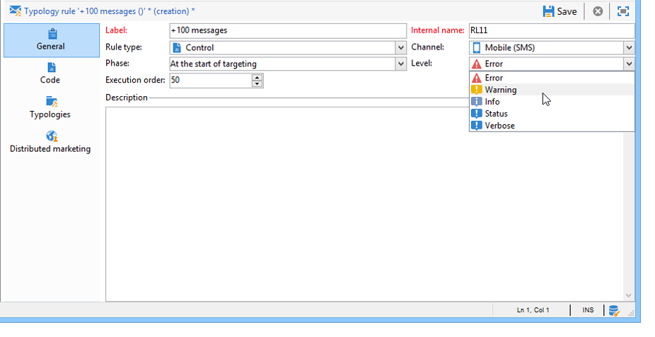
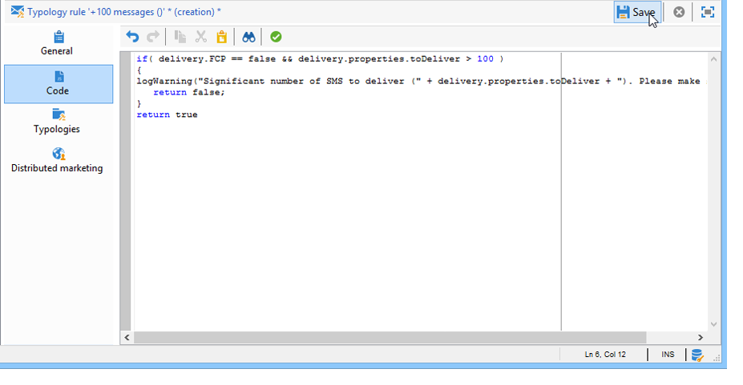
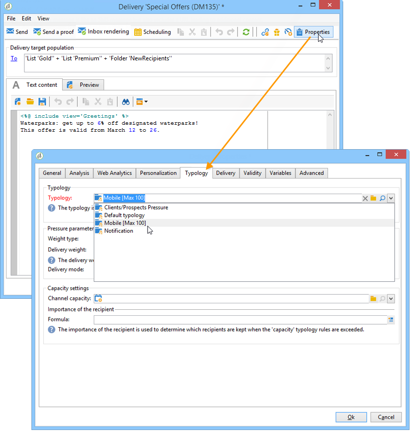
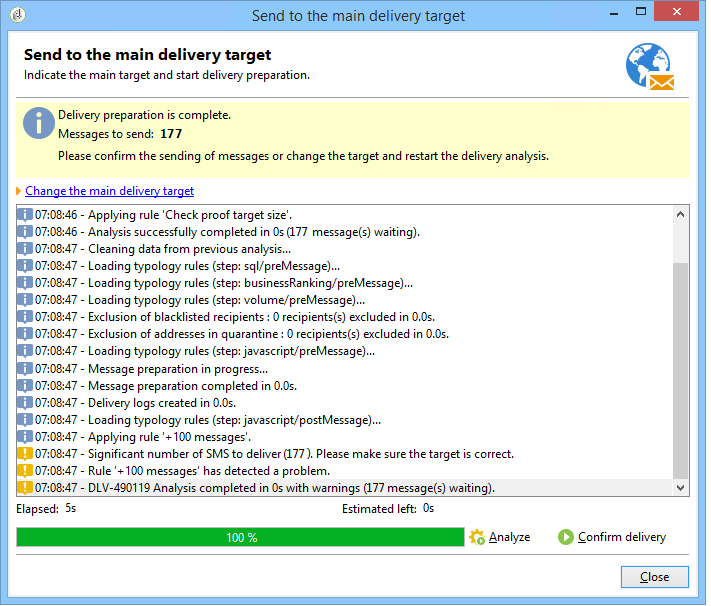
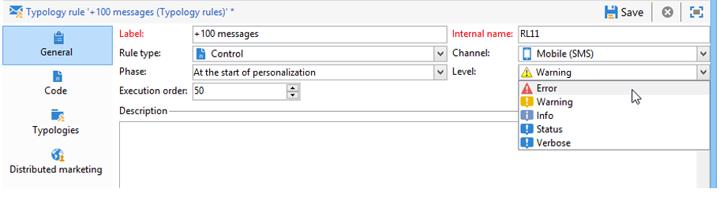
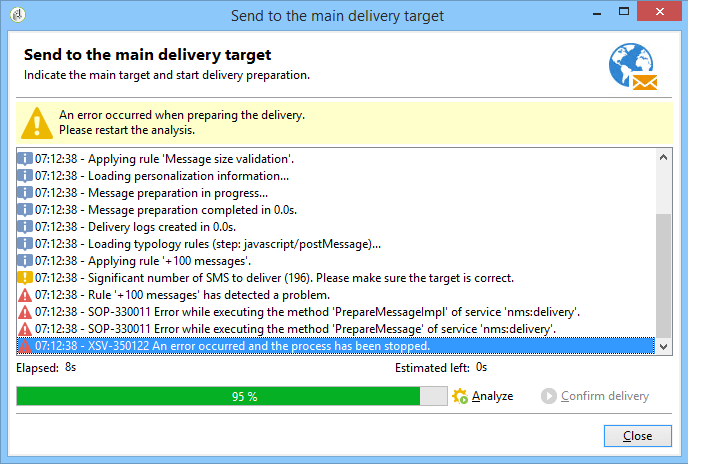

# Reglas de control{#control-rules}

Las reglas de control permiten garantizar la validez y calidad de los mensajes antes de la entrega: visualización de caracteres, tamaño de SMS, formato de dirección, etc.

Un conjunto de reglas predeterminadas permite realizar comprobaciones habituales. Estas comprobaciones (que aparecen en negrita en la interfaz) son:

* **[!UICONTROL Object approval]** (correo electrónico): comprueba que el objeto de remitente y la dirección no contienen caracteres especiales que podrían causar problemas en determinados agentes de correo.
* **[!UICONTROL URL label approval]** (correo electrónico): comprueba que cada URL de seguimiento tiene una etiqueta.
* **[!UICONTROL URL approval]** (correo electrónico): comprueba las URL de seguimiento (presencia del carácter “&amp;”).
* **[!UICONTROL Message size approval]** (móvil): comprueba el tamaño de los mensajes SMS.
* **[!UICONTROL Validity period check]** (correo electrónico): comprueba que el periodo de validez de la entrega sea lo suficientemente largo como para enviar todos los mensajes.
* **[!UICONTROL Proof size check]** (todos los canales): genera un mensaje de error si la población de destino de prueba supera los 100 destinatarios.
* **[!UICONTROL Wave scheduling check]** (correo electrónico): comprueba que la última tanda de envíos está programada para iniciarse antes del final del periodo de validez, si la entrega se divide en varias tandas.
* **[!UICONTROL Unsubscription link approval]** (correo electrónico): comprueba la presencia de al menos una URL de baja (exclusión) en cada contenido (HTML y texto).

## Creación de una regla de control {#create-a-control-rule}

Es posible crear nuevas reglas de control para adaptarlas a sus necesidades. Para ello, cree una regla de tipología de **[!UICONTROL Control]** e introduzca la fórmula de control en SQL en la pestaña **[!UICONTROL Code]**.

**Ejemplo:**

En el siguiente ejemplo creamos una regla para evitar que una oferta SMS se envíe a más de 100 destinatarios. Esta regla se vincula a una tipología de campaña y luego a las entregas de SMS para los que la oferta relacionada está disponible.

Siga estos pasos:

1. Cree una regla de tipología de **[!UICONTROL Control]**. Seleccione un nivel de alerta **[!UICONTROL Warning]**.

   

1. En la pestaña **[!UICONTROL Code]**, introduzca la secuencia de comandos para aplicar el umbral deseado, como se muestra a continuación:

   

   Esta secuencia de comandos activa una advertencia si la entrega supera los 100 destinatarios:

   ```
   if( delivery.FCP == false && delivery.properties.toDeliver > 100 ) { logWarning("Significant number of SMS to deliver (" + delivery.properties.toDeliver + "). Please make sure the target is correct.") return false; } return true
   ```

1. Vincule esta regla a una tipología de campaña y haga referencia a la tipología en la entrega de SMS correspondiente.

   

1. Durante el análisis de envío, se aplica la regla y se crea una advertencia si procede.

   

   Sin embargo, la entrega está listo para realizarse.

   Si aumenta el nivel de alerta, esto impide que se inicie la entrega.

   

   Al final del análisis, el botón **[!UICONTROL Confirm delivery]** deja de estar disponible.

   
