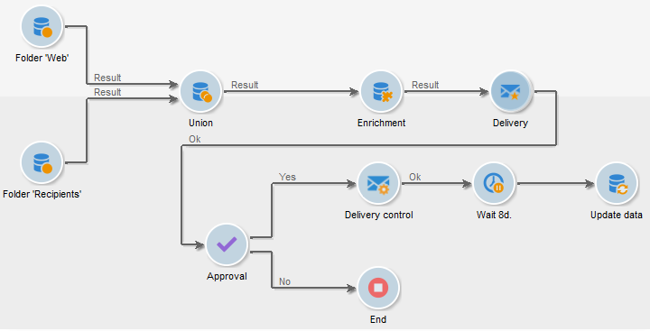

# Introducción a los flujos de trabajo{#gs-workflows}

## Acerca de los flujos de trabajo{#about-workflows}

Adobe Campaign incluye un módulo de flujos de trabajo que permite organizar la gama completa de procesos y tareas en los distintos módulos del servidor de aplicaciones. Este entorno gráfico completo permite diseñar procesos que incluyen la segmentación, la ejecución de campañas, el procesamiento de archivos, la participación humana, etc. El motor de flujo de trabajo se ejecuta y rastrea estos procesos.

Se puede utilizar un flujo de trabajo, por ejemplo, para descargar un archivo de un servidor, descomprimirlo y, a continuación, importar registros de la base de datos de Adobe Campaign.

Un flujo de trabajo también puede incluir uno o varios operadores por notificar o que pueden realizar acciones y aprobar procesos. De este modo, es posible crear una acción de envío, asignar una tarea a uno o varios operadores para trabajar en el contenido, especificar objetivos y verificar pruebas antes de iniciar la entrega.

Los flujos de trabajo se producen en varios contextos y etapas del proceso de administración de campañas.

Adobe Campaign utiliza flujos de trabajo para:

* Diseñar flujos de trabajo de segmentación. [Más información](#targeting-workflows)
* Organización de campañas en canales múltiples. [Más información](#campaign-workflows)
* Realice procesos técnicos, como limpieza, recopilación de seguimiento de datos, cálculos, etc. [Más información](#technical-workflows)

El flujo de trabajo es una definición de proceso: el diagrama de flujo de trabajo, que es una representación de lo que se supone que debe suceder. Un flujo de trabajo también es una instancia de este proceso: una instancia de flujo de trabajo, que es una representación de lo que realmente está ocurriendo.

La plantilla de flujo de trabajo describe las diversas tareas que se realizan y cómo se relacionan entre sí. Las plantillas de tareas se denominan actividades y se representan mediante iconos. Se vinculan entre sí mediante transiciones.

## Principios clave

Cada flujo de trabajo contiene:

* **[!UICONTROL Activities]**

  Una actividad describe una plantilla de tarea. Las distintas actividades disponibles se representan en el diagrama mediante iconos. Cada tipo tiene propiedades comunes y propiedades específicas. Por ejemplo, mientras que todas las actividades tienen un nombre y una etiqueta, solo la actividad **[!UICONTROL Approval]** tiene una asignación.

  En un diagrama de flujo de trabajo, una actividad determinada puede producir varias tareas, en particular cuando hay un bucle o una acción recurrente (periódica).

  Todas las actividades de flujo de trabajo se enumeran en [Acerca de las actividades de flujo de trabajo](activities.md), incluidos los casos de uso y las muestras.

* **[!UICONTROL Transitions]**

  Las transiciones permiten vincular actividades y definir su secuencia. Una transición vincula una actividad de origen a una actividad de destino. Existen varios tipos de transiciones que dependen de la actividad de origen. Algunas transiciones tienen parámetros adicionales, como una duración, una condición o un filtro.

  Una transición que no está vinculada a una actividad de destino aparece en color naranja, y la cabeza de la flecha se muestra como un diamante.

  >[!NOTE]
  >
  >Se puede ejecutar igualmente un flujo de trabajo que contenga transiciones no finalizadas: se genera un mensaje de advertencia y el flujo de trabajo se pausa una vez que llega a la transición, pero no genera un error. Por lo tanto, es posible iniciar un flujo de trabajo sin que haya terminado y añadirlo a medida que avanza

  Para obtener más información sobre cómo generar un flujo de trabajo, consulte [Generar un flujo de trabajo](build-a-workflow.md).

* **[!UICONTROL Worktables]**

  La tabla de trabajo contiene toda la información que transmite la transición. Cada flujo de trabajo utiliza varias tablas de trabajo. Los datos transmitidos en estas tablas pueden acelerarse y utilizarse en todo el ciclo de vida del flujo de trabajo, siempre y cuando no se depure. De hecho, las tablas innecesarias se depuran cada vez que se desactiva el flujo de trabajo y posiblemente durante la ejecución de los flujos de trabajo más grandes para evitar sobrecargar el servidor.

  Obtenga más información sobre tablas y datos de flujo de trabajo en [Usar datos de flujo de trabajo](use-workflow-data.md).

## Secciones relacionadas

Consulte estas secciones para ver instrucciones y prácticas recomendadas para automatizar procesos con flujos de trabajo:

* Obtenga más información acerca de las actividades de flujo de trabajo en [Usar datos de flujo de trabajo](use-workflow-data.md).
* Aprenda a crear un flujo de trabajo en [Crear un flujo de trabajo](build-a-workflow.md).
* Descubra cómo usar flujos de trabajo para importar datos en Campaign en [Tipo de flujos de trabajo](campaign-workflows.md).
* Las prácticas recomendadas de flujo de trabajo se detallan en [Prácticas recomendadas de flujo de trabajo](workflow-best-practices.md).
* Encuentre orientación sobre la ejecución del flujo de trabajo en [Iniciar un flujo de trabajo](start-a-workflow.md).
* Aprenda a monitorizar los flujos de trabajo en [Supervisar la ejecución del flujo de trabajo](monitor-workflow-execution.md).
* Aprenda a conceder acceso a los usuarios para que utilicen flujos de trabajo en [Administrar permisos de flujo de trabajo](managing-rights.md).
