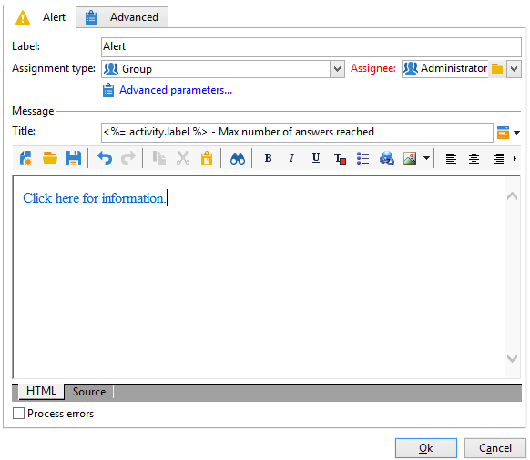

# Alerta{#alert}

Una actividad de **Alert** envía un mensaje a un grupo de operadores. Funciona del mismo modo que una actividad de aprobación, pero no se espera ninguna respuesta en este caso.

Una alerta no es persistente y, por lo tanto, no es visible desde la consola del cliente. Los operadores del grupo asignado deben tener una dirección de correo electrónico completa para recibir la notificación. La configuración de esta actividad es similar a la de una **Approval**. La plantilla de entrega predeterminada utilizada para alertar a los operadores es &#39;alertAssignee&#39;.
