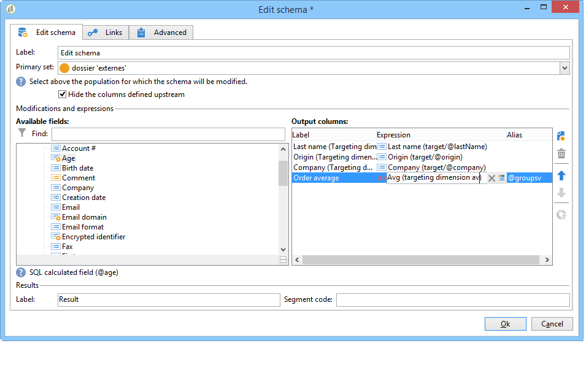
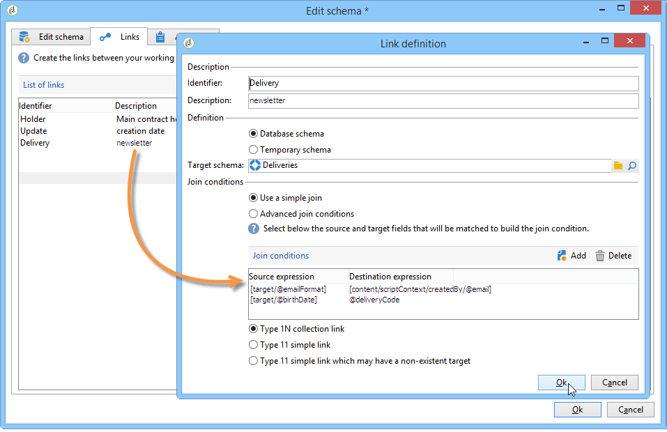

# Edición del esquema{#edit-schema}

En el flujo de trabajo, los datos se pueden transformar, normalizar y, si es necesario, ampliar utilizando la actividad **[!UICONTROL Edit schema]**. Se suele utilizar para normalizar la estructura de datos: puede cambiar el nombre de las columnas de salida o modificar su contenido, por ejemplo, calculando los valores promedio de un campo o agregados.

Esta actividad no cambia los datos de la tabla de trabajo, solo cambia su esquema, es decir, la vista lógica de los datos.

También se pueden crear vínculos con otras tablas de trabajo a través de la pestaña **[!UICONTROL Links]**.

La sección inferior permite configurar la lista de condiciones del vínculo, es decir, los criterios utilizados para reconciliar los datos de las dos tablas.
