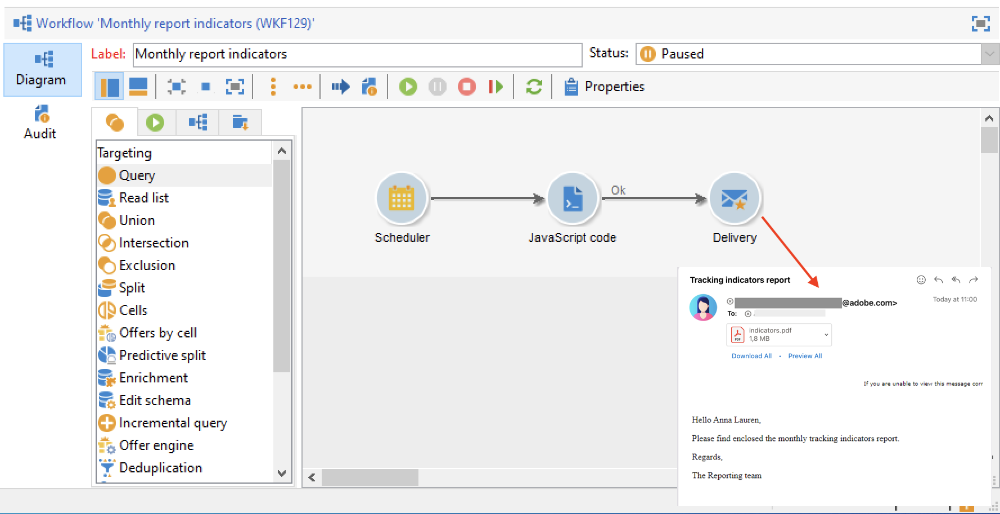
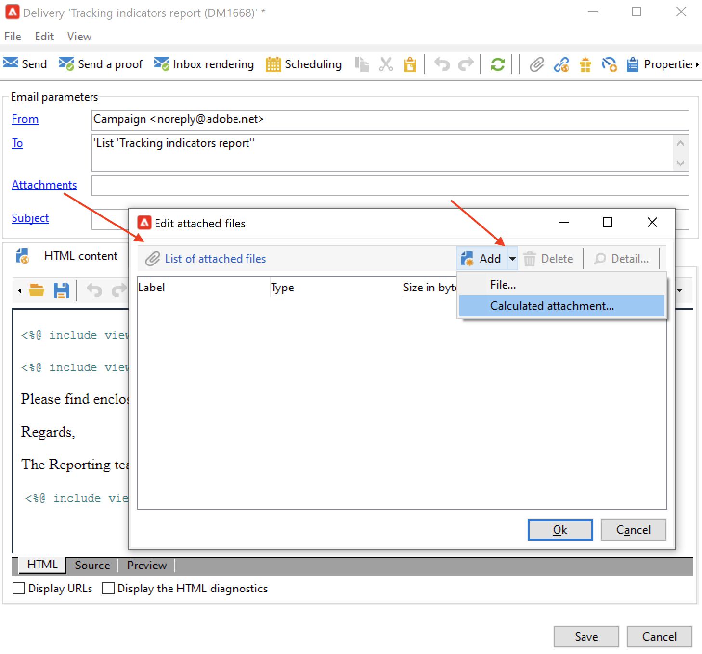
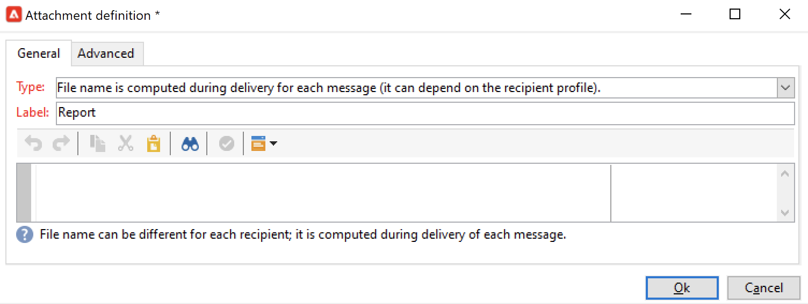
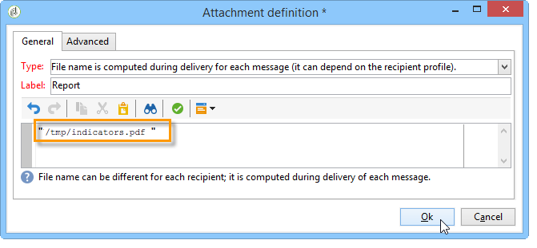
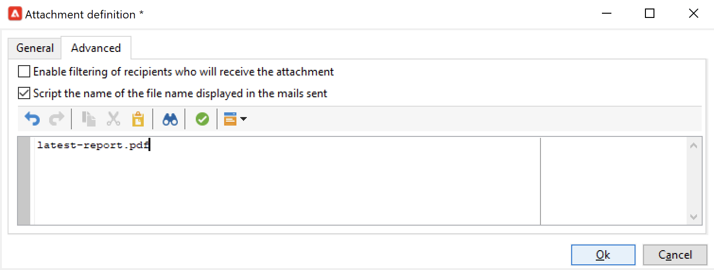
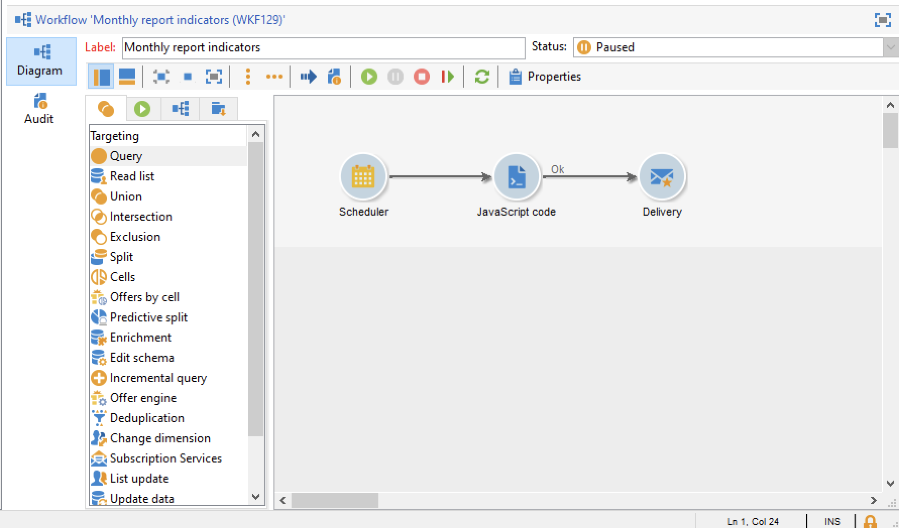
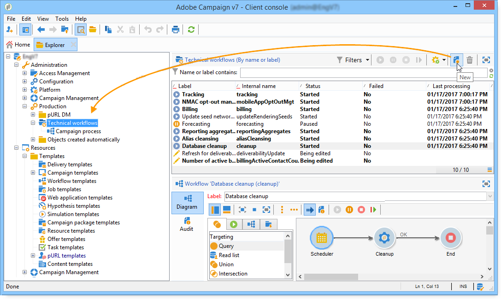
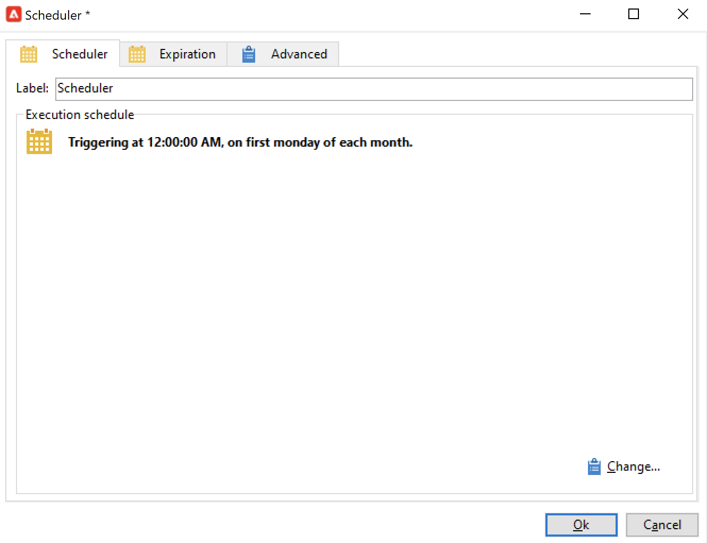
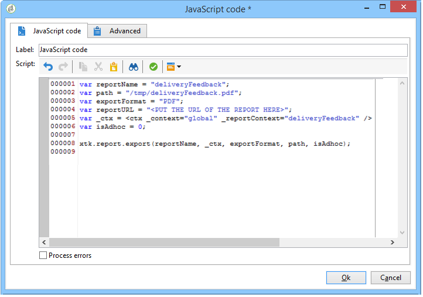
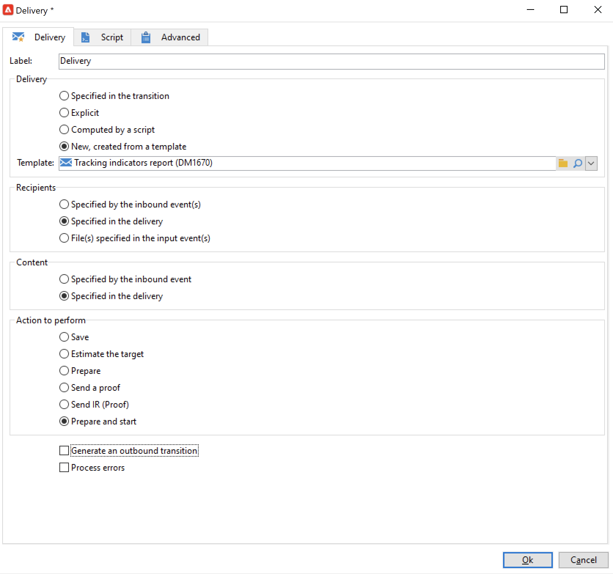

# Envío de un informe a una lista{#send-a-report-to-a-list}

Este caso de uso detalla cómo generar un informe mensual preestablecido de **[!UICONTROL Tracking indicators]** en formato PDF y cómo enviarlo a una lista de destinatarios.



Los pasos de implementación principales para este caso de uso son:

* Cree una lista de destinatarios para este informe. [Más información](#step-1--create-the-recipient-list).
* Cree una plantilla de envíos que cree un nuevo envío cada vez que se ejecute el flujo de trabajo. [Más información](#step-2--create-the-delivery-template).
* Cree un flujo de trabajo que genere el informe en formato PDF y lo envíe a la lista de destinatarios. [Más información](#step-3--create-the-workflow)).

## Paso 1: Creación de la lista de destinatarios {#step-1--create-the-recipient-list}

Para crear la lista de destinatarios objetivo, siga los pasos a continuación:

1. Vaya a la ficha **[!UICONTROL Profiles and targets]** y haga clic en el vínculo **[!UICONTROL Lists]**.
1. Haga clic en el botón **[!UICONTROL Create]**.
1. Seleccione **[!UICONTROL New list]** y cree una nueva lista de destinatarios a los que enviar el informe.

Para obtener más información sobre la creación de listas, consulte [Crear audiencias de perfil en Campaign](../../v8/audiences/create-audiences.md).

## Paso 2: Creación de la plantilla de envíos {#step-2--create-the-delivery-template}

Para crear la plantilla de envío, siga los pasos a continuación:

1. Vaya al nodo **[!UICONTROL Resources > Templates > Delivery templates]** del explorador de Adobe Campaign y duplique la plantilla integrada **[!UICONTROL Email delivery]**.

   Para obtener más información sobre cómo crear una plantilla de envíos, consulte [Trabajar con plantillas de envíos](../../v8/send/create-templates.md).

1. Introduzca los parámetros de plantilla: etiqueta, objetivo (la lista de destinatarios creados anteriormente), asunto y contenido.

   Cada vez que se ejecuta el flujo de trabajo, el informe **[!UICONTROL Tracking indicators]** se actualiza tal como se explica en [Paso 3: Crear el flujo de trabajo](#step-3--creating-the-workflow)).

1. Para incluir la versión más reciente del informe en la entrega, se debe añadir un **[!UICONTROL Calculated attachment]**:

   * Haga clic en el vínculo **[!UICONTROL Attachments]** y luego en la flecha situada junto al botón **[!UICONTROL Add]**. Seleccione **[!UICONTROL Calculated attachment...]**.

     

   * En la lista desplegable **[!UICONTROL Type]**, seleccione la última opción: **[!UICONTROL File name is computed during delivery of each message (it may then depend on the recipient profile)]**.

     

     El valor introducido en el campo **[!UICONTROL Label]** no aparece en la entrega final.

   * En la zona de texto, introduzca la ruta de acceso y el nombre del archivo.

     

     >[!CAUTION]
     >
     >La ruta y el nombre deben ser idénticos a los introducidos en la actividad de tipo **[!UICONTROL JavaScript code]** del flujo de trabajo, como se explica en [Paso 3: Crear el flujo de trabajo](#step-3--creating-the-workflow).

   * Seleccione la pestaña **[!UICONTROL Advanced]** y marque **[!UICONTROL Script the name of the file name displayed in the mails sent]**. En el área de texto, introduzca el nombre del archivo adjunto en la entrega final.

     

## Paso 3: Creación del flujo de trabajo {#step-3--creating-the-workflow}

Cree el siguiente flujo de trabajo para este caso de uso.



Utiliza tres actividades:

* Una actividad **[!UICONTROL Scheduler]** que ejecuta el flujo de trabajo una vez al mes,
* Una actividad **[!UICONTROL JavaScript code]** que genera el informe en formato PDF,
* Una actividad **[!UICONTROL Delivery]** que hace referencia a la plantilla de envío creada anteriormente.

Para crear este flujo de trabajo, siga los pasos a continuación:

1. Vaya al nodo **[!UICONTROL Administration > Production > Technical workflows]** del explorador de Campaign y cree una nueva carpeta para almacenar los flujos de trabajo.
1. Cree un nuevo flujo de trabajo.

   

1. Comience agregando una actividad **[!UICONTROL Scheduler]** y configúrela para que el flujo de trabajo se ejecute en el primer lunes del mes.

   

   Para obtener más información sobre la configuración del planificador, consulte [planificador](scheduler.md).

1. A continuación, añada una actividad **[!UICONTROL JavaScript code]**.

   

   Introduzca el código siguiente en la zona de edición:

   ```sql
   var reportName = "indicators";
   var path = "/tmp/indicators.pdf";
   var exportFormat = "PDF";
   var reportURL = "<PUT THE URL OF THE REPORT HERE>";
   var _ctx = <ctx _context="global" _reportContext="deliveryFeedback" />
   var isAdhoc = 0;
   
   xtk.report.export(reportName, _ctx, exportFormat, path, isAdhoc);
   ```


   con las siguientes variables:

   * **var reportName**: introduzca el nombre interno del informe en comillas dobles. En este caso, el nombre interno del informe **Indicador de seguimiento** es “deliveryFeedback”.
   * **var path**: escriba la ruta de acceso de guardado del archivo (&quot;tmp&quot;), el nombre que desee dar al archivo (&quot;deliveryFeedback&quot;) y la extensión de archivo (&quot;.pdf&quot;). En este caso, se ha utilizado el nombre interno como nombre de archivo. Los valores deben estar entre comillas dobles y separados por el carácter “+”.

     >[!CAUTION]
     >
     >El archivo debe guardarse en el servidor. Debe escribir la misma ruta de acceso y el mismo nombre que en la ficha **[!UICONTROL General]** de la ventana de edición para el archivo adjunto calculado, como se detalla en [Paso 2: crear la plantilla de envío](#step-2--create-the-delivery-template)).

   * **var exportFormat**: introduzca el formato de exportación del archivo (“PDF”).
   * **var _ctx** (contexto): en este caso, se utiliza el informe **[!UICONTROL Tracking indicators]** en su contexto global.

1. Para terminar, agregue una actividad **[!UICONTROL Delivery]** con las siguientes opciones:

   

   * **[!UICONTROL Delivery]**: seleccione **[!UICONTROL New, created from a template]** y la plantilla de envíos creada anteriormente.
   * Para los campos **[!UICONTROL Recipients]** y **[!UICONTROL Content]** , seleccione **[!UICONTROL Specified in the delivery]**.
   * **[!UICONTROL Action to perform]**: Seleccione **[!UICONTROL Prepare and start]**.
   * Desmarque las opciones **[!UICONTROL Generate an outbound transition]** y **[!UICONTROL Process errors]**.

1. Guarde los cambios e inicie el flujo de trabajo. El mensaje se envía a la lista de destinatarios cada primer lunes del mes, con el informe adjunto.
