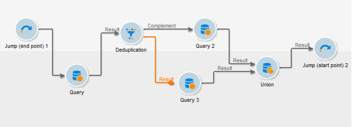
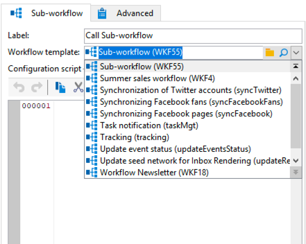
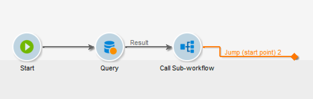
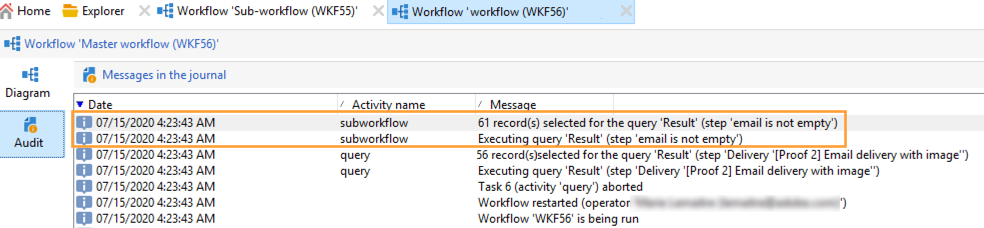

# Subflujo de trabajo{#sub-workflow}

La actividad **[!UICONTROL Sub-workflow]** permite activar la ejecución de otro flujo de trabajo y recuperar el resultado. Esta actividad permite utilizar flujos de trabajo complejos mientras se utiliza una interfaz simplificada.

Puede activar varios subflujos de trabajo en un solo flujo de trabajo. Los subflujos de trabajo se ejecutan de forma sincrónica.

En el ejemplo siguiente, un flujo de trabajo principal llama a un subflujo de trabajo mediante saltos. Para obtener más información sobre los objetos gráficos de tipo salto, consulte [Salto (puntos iniciales y finales)](jump-start-point-and-end-point.md).

1. Cree un flujo de trabajo que utilizará como subflujo de trabajo en otro flujo de trabajo.
1. Inserte una actividad **[!UICONTROL Jump (end point)]** con una prioridad de 1 al principio del flujo de trabajo. Si tiene varios saltos del tipo &quot;llegada&quot;, Adobe Campaign utiliza el salto de &quot;llegada&quot; con el número más bajo.
1. Inserte una actividad **[!UICONTROL Jump (start point)]** con una prioridad de 2 al final del flujo de trabajo. Si tiene varios saltos del tipo &quot;inicio&quot;, Adobe Campaign utiliza el salto &quot;inicio&quot; con el número más alto.

   

   >[!NOTE]
   >
   >Si la actividad de subflujo de trabajo hace referencia a un flujo de trabajo con varias actividades **[!UICONTROL Jump]**, se ejecuta el subflujo de trabajo entre el salto de tipo &quot;llegada&quot; con el número más bajo y el salto de tipo &quot;inicio&quot; con el número más alto.
   >
   >Para que el subflujo de trabajo se ejecute correctamente, solo debe haber un único salto de tipo &quot;llegada&quot; con el número más bajo y un único salto de tipo de &quot;inicio&quot; con el número más alto.

1. Complete y guarde este &quot;subflujo de trabajo&quot;.
1. Cree un flujo de trabajo principal.
1. Inserte una actividad **[!UICONTROL Sub-workflow]** y ábrala.
1. Seleccione el flujo de trabajo que desee utilizar en la lista desplegable **[!UICONTROL Workflow template]**.

   

1. También puede agregar un script de configuración para alterar el flujo de trabajo al que se hace referencia.
1. Haga clic **[!UICONTROL Ok]**. Se crea automáticamente una transición saliente con la etiqueta de la actividad **[!UICONTROL Jump (start point)]** del flujo de trabajo seleccionado.

   

1. Ejecute el flujo de trabajo.

Una vez ejecutado, el flujo de trabajo llamado como subflujo de trabajo permanece en estado **[!UICONTROL Being edited]**, lo que significa lo siguiente:

* No puede hacer clic con el botón derecho en las transiciones para mostrar el destino.
* No se puede mostrar el recuento de poblaciones intermedias.
* Los registros de subflujo de trabajo se muestran en el flujo de trabajo principal.

  

>[!NOTE]
>
>Si se produce algún error en el subflujo de trabajo, el flujo de trabajo principal se pausa y se crea una copia del subflujo de trabajo.

## Parámetros de entrada (opcional) {#input-parameters--optional-}

* tableName
* esquema

Cada evento entrante debe especificar un objetivo definido por estos parámetros.

## Parámetros de salida {#output-parameters}

* tableName
* esquema
* recCount

Este conjunto de tres valores identifica la población objetivo de la consulta. **[!UICONTROL tableName]** es el nombre de la tabla que registra los identificadores de destinatario, **[!UICONTROL schema]** es el esquema de la población (normalmente, nms:recipient) y **[!UICONTROL recCount]** es el número de elementos de la tabla.

* targetSchema: Este valor es el esquema de la tabla de trabajo. Este parámetro es válido para todas las transiciones con **[!UICONTROL tableName]** y **[!UICONTROL schema]**.
