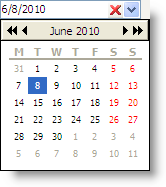

# Fecha

Un control de tipo fecha permite introducir una fecha.

## Propiedades

**backColor - string** Color de fondo (btnshadow, blanco).

**border - string** Cambia el estilo del borde durante el control (solid, double, inset, begin, none).

**tamaño de fuente - entero** Cambia el tamaño de fuente.

**etiqueta - cadena** Etiqueta asociada.

**nolabel - booleano**: oculta la etiqueta asociada.

**readOnly - boolean** fuerza al control a ser de solo lectura.

**obligatorio - booleano** El campo es obligatorio.

## Observaciones

Puede utilizar este control para hacer referencia a un campo de tipo datetime y modificar sólo la parte de fecha; la parte de tiempo se restablecerá en cero.
