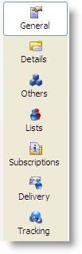

# Iconbox

Lista de iconos que permiten seleccionar varias páginas.



## Propiedades

**backColor - string** Color de fondo (btnshadow, blanco).

**nombre - cadena** ID de contenedor.

**padding-left - integer** espacio en píxeles a la izquierda del contenedor.

**padding-right - integer** espacio en píxeles a la derecha del contenedor.

**padding-top - integer** espacio en píxeles por encima del contenedor.

**padding-bottom - integer** espacio en píxeles debajo del contenedor.

**relleno - entero** Espacio en píxeles alrededor del contenedor.

**readOnly - boolean** fuerza al control y a todos sus descendientes a leer solamente.

## Observaciones

Cada subelemento contenedor representa una página. Ejemplo:

```xml
<container name="iconbox" type="iconbox">
   <container colcount="3" label="Header">
     ...
   </container>
   <container img="ncm:ctprop.bmp" label="Intro">
     ...
   </container>
   <container img="ncm:subsection.bmp" label="Event">
     ...
   </container>
   <container img="ncm:book.bmp" label="Selection">
     ...
   </container>
   <container img="nms:contacts.bmp" label="Services">
     ...
   </container>
   <container img="nms:contacts.bmp" label="Mail footer ">
     ...
   </container>
 </container>
```
