# Trabajo con Campaign y Adobe Experience Manager {#ac-aem}

La integración entre Adobe Campaign y Adobe Experience Manager le permite gestionar el contenido de las entregas de los correos electrónicos y los formularios directamente en Adobe Experience Manager.

## Uso de Adobe Experience Manager as a Cloud Service con la interfaz de usuario web de Campaign {#aem-cs-web-ui}

Con la interfaz de usuario web de Campaign, puede conectar su entorno de Adobe Experience Manager as a Cloud Service para centralizar el contenido. Una única fuente fiable para recursos y plantillas mantiene la coherencia de los mensajes de correo electrónico en todos los canales y evita la duplicación de contenido entre las dos soluciones.

* **Assets**: administre sus recursos en Adobe Experience Manager Assets y reutilícelos directamente en el contenido de su correo electrónico. [Más información](https://experienceleague.adobe.com/es/docs/campaign-web/v8/integrations/aem-assets){target="_blank"}
* **Plantillas**: cree y apruebe plantillas de correo electrónico en Adobe Experience Manager as a Cloud Service y, a continuación, utilícelas como plantillas de contenido en las entregas. [Más información](https://experienceleague.adobe.com/es/docs/campaign-web/v8/integrations/aem-content){target="_blank"}

La conexión depende de una cuenta externa **[!UICONTROL AEM]** configurada en la consola del cliente. Ver [Cuentas externas](../config/external-accounts.md).

## Uso de Adobe Experience Manager con la consola del cliente {#aem-console}

Las secciones siguientes describen la integración en la consola del cliente de Campaign.

[Obtenga más información acerca de Adobe Experience Manager en este documento](https://experienceleague.adobe.com/docs/experience-manager-65/administering/integration/campaignonpremise.html?lang=es#aem-and-adobe-campaign-integration-workflow){target="_blank"}.

>[!NOTE]
>
>Como usuario de Cloud Services administrados, [póngase en contacto con Adobe](../start/campaign-faq-comprehensive.md#support) para integrar Adobe Experience Manager con Campaign.

## Importación de contenido desde Adobe Experience Manager {#integrating-with-aem}

Esta integración puede utilizarse, por ejemplo, para crear un “newsletter” en Adobe Experience Manager para su uso posterior en Adobe Campaign como parte de una campaña de correo electrónico.

**Desde Adobe Experience Manager:**

1. Vaya a la instancia de autor de [!DNL Adobe Experience Manager] y haga clic en Adobe Experience en la esquina superior izquierda de la página. Elija **[!UICONTROL Sites]** en el menú.

   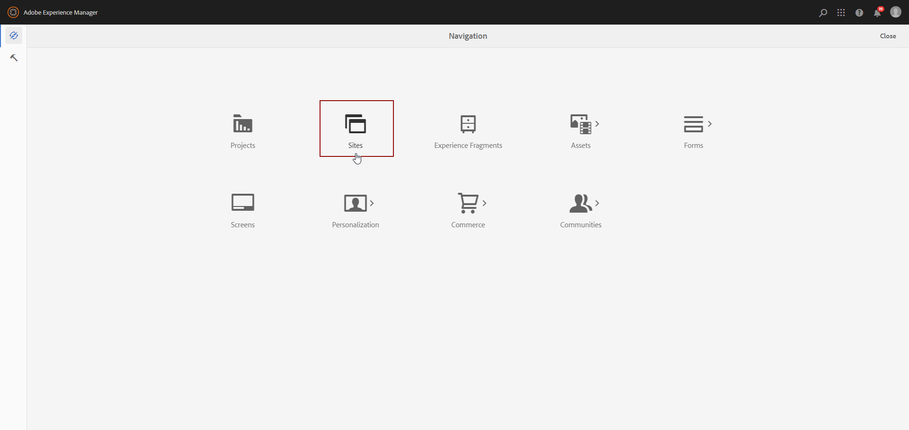

1. Acceso **[!UICONTROL Campaigns > Name of your brand (here we.Shopping) > Main Area > Email]**.

1. Haga clic en **[!UICONTROL Create]** y seleccione **[!UICONTROL Page]** en el menú desplegable.

   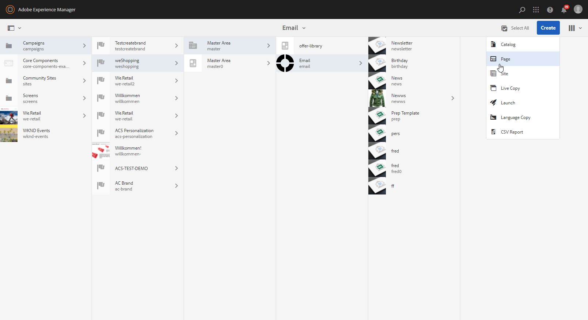

1. Seleccione la plantilla de **[!UICONTROL Adobe Campaign Email]** y asigne un nombre al newsletter.

1. Después de crear su página, acceda al menú **[!UICONTROL Page information]** y haga clic en **[!UICONTROL Open Properties]**.

   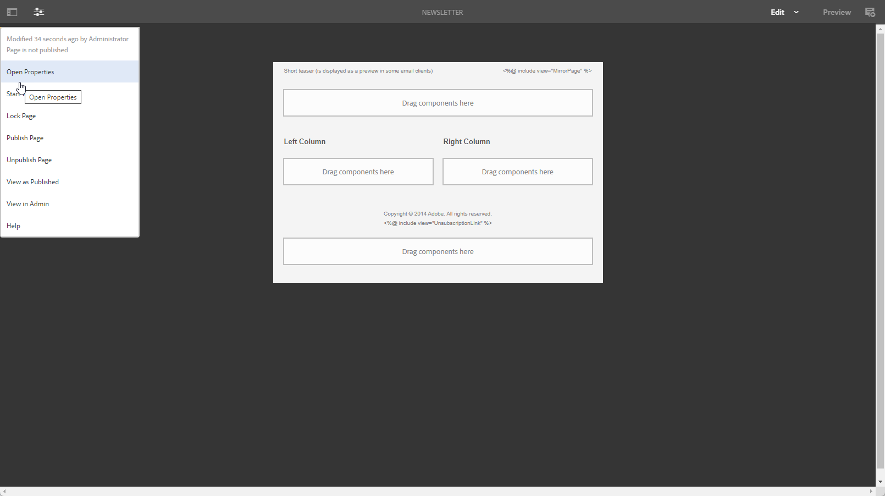

1. Personalice el contenido del correo electrónico añadiendo componentes como, por ejemplo, campos de personalización de Adobe Campaign. Obtenga más información en [Documentación de Adobe Experience Manager](https://experienceleague.adobe.com/docs/experience-manager-65/content/sites/authoring/aem-adobe-campaign/campaign.html?lang=es#editing-email-content){target="_blank"}.

1. Cuando el correo electrónico esté listo, vaya al menú **[!UICONTROL Page information]** y haga clic en **[!UICONTROL Start workflow]**.

   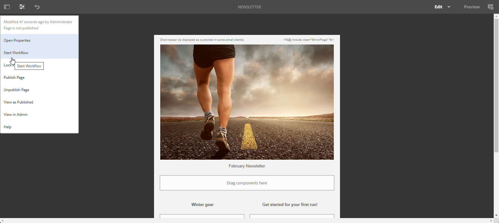

1. En la primera lista desplegable, seleccione **[!UICONTROL Approve Adobe Campaign]** como modelo de flujo de trabajo y haga clic en **[!UICONTROL Start workflow]**.

   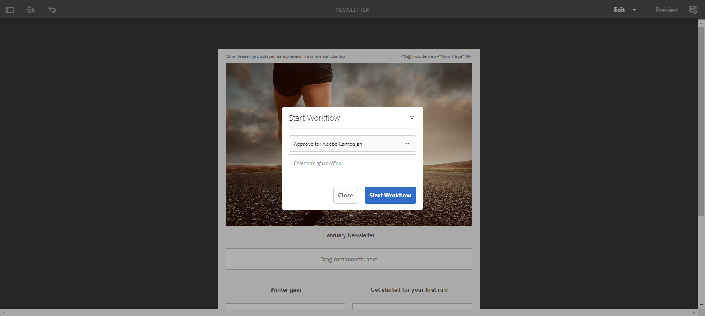

1. Aparecerá un aviso de exención de responsabilidad en la parte superior de la página que indica `This page is subject to the workflow Approve for Adobe Campaign`. Haga clic en **[!UICONTROL Complete]** al lado del aviso legal para confirmar la revisión y luego haga clic en **[!UICONTROL Ok]**.

1. Vuelva a hacer clic en **[!UICONTROL Complete]** y seleccione **[!UICONTROL Newsletter approval]** en la lista desplegable **[!UICONTROL Next Step]**.

   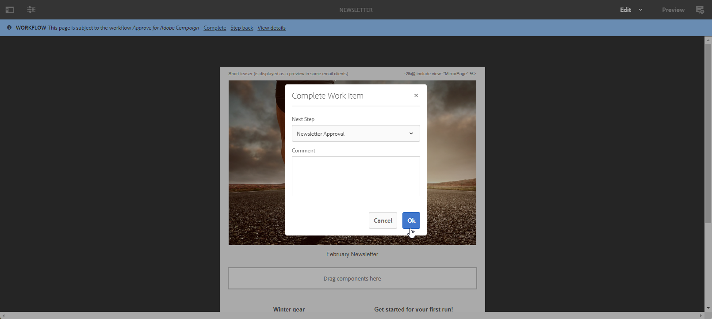

El boletín ya está listo y sincronizado en Adobe Campaign.

**Desde Adobe Campaign:**

1. En la pestaña **[!UICONTROL Campaigns]** , haga clic en **[!UICONTROL Deliveries]** luego **[!UICONTROL Create]**.

1. Elija la plantilla **[!UICONTROL Email delivery with AEM content (mailAEMContent)]** del menú desplegable **[!UICONTROL Delivery template]**.

   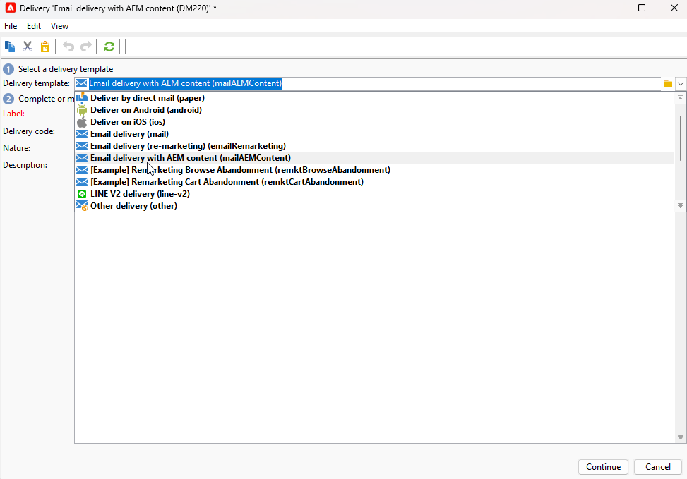

1. Añada a la entrega una **[!UICONTROL Label]** y haga clic en **[!UICONTROL Continue]**.

1. Haga clic en **[!UICONTROL Synchronize]** para acceder a sus envíos de AEM.

   Si el botón no está visible en la interfaz, vaya al botón **[!UICONTROL Properties]** y acceda a la pestaña **[!UICONTROL Advanced]**. Asegúrese de que el campo **[!UICONTROL Content editing mode]** esté configurado en **[!UICONTROL AEM]** e introduzca los detalles de la instancia de AEM en el campo **[!UICONTROL AEM account]**.

   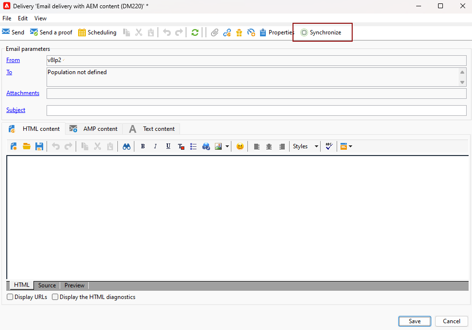

1. Seleccione la entrega de AEM creada anteriormente en [!DNL Adobe Experience Manager] y confirme haciendo clic en **[!UICONTROL Ok]**.

   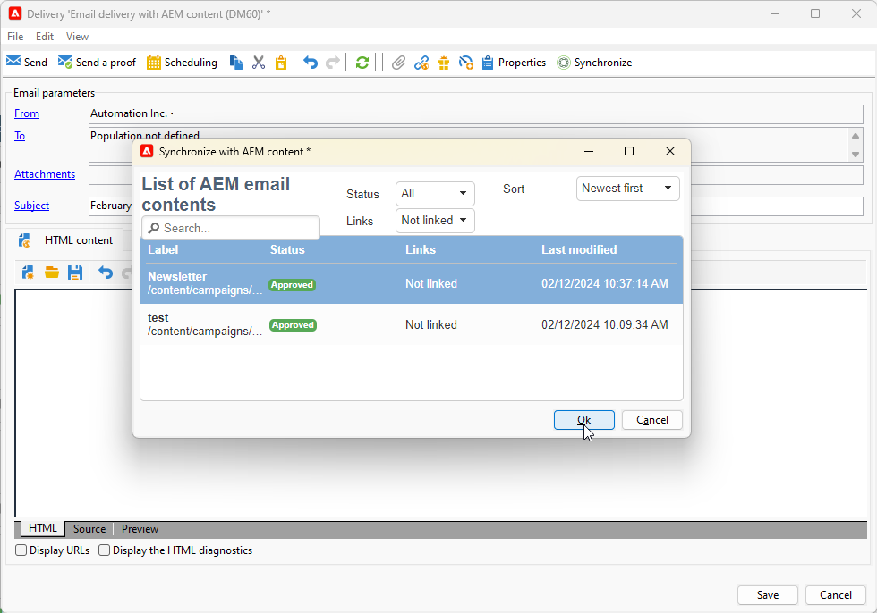

1. Asegúrese de hacer clic en el botón **[!UICONTROL Refresh content]** cada vez que se realicen modificaciones en la entrega de AEM.

   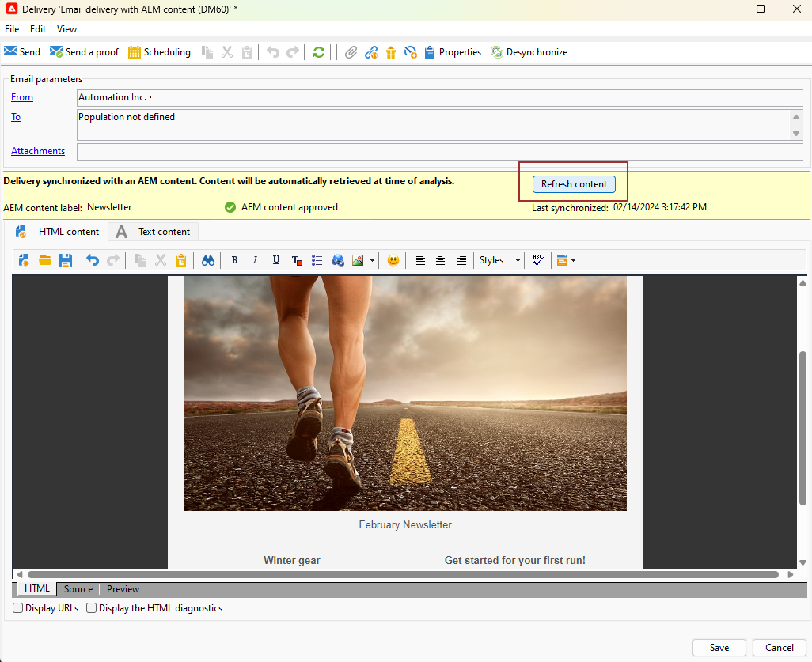

1. Para eliminar la vinculación entre Experience Manager y Campaign, haga clic en **[!UICONTROL Desynchronize]**.

El correo electrónico está listo para enviarse a la audiencia.

## Importar recursos desde la biblioteca de Adobe Experience Manager Assets {#assets-library}

También puede insertar recursos directamente desde su [!DNL Adobe Experience Manager Assets Library] mientras edita un mensaje de correo electrónico o una página de aterrizaje en Adobe Campaign. Esta funcionalidad se encuentra detallada en [Documentación de Adobe Experience Manager Assets](https://experienceleague.adobe.com/docs/experience-manager-65/content/assets/managing/manage-assets.html?lang=es){target="_blank"}.

**Desde Adobe Experience Manager:**

1. Vaya a la instancia de autor de [!DNL Adobe Experience Manager] y haga clic en Adobe Experience en la esquina superior izquierda de la página. Elija **[!UICONTROL Assets]** `>` **[!UICONTROL Files]** en el menú.

   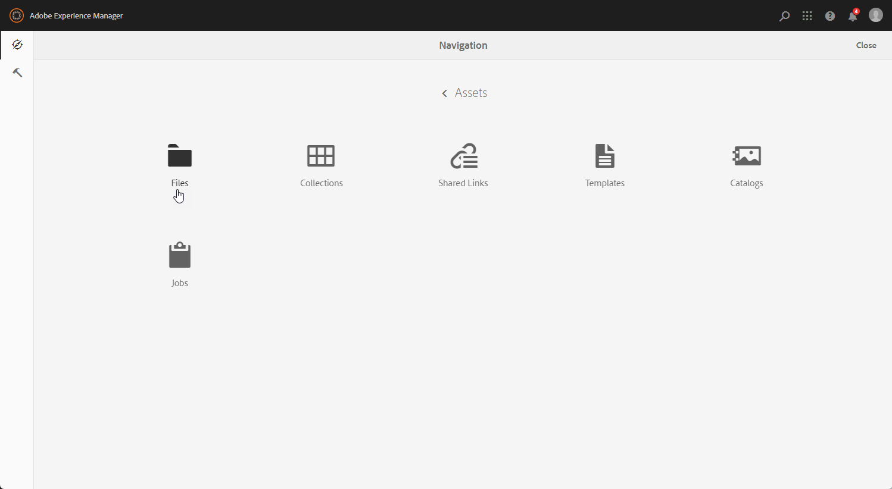

1. Haga clic en **Crear** y luego en **Archivos** para importar el recurso en la **biblioteca de Adobe Experience Manager Assets**. Obtenga más información en [Documentación de Adobe Experience Manager](https://experienceleague.adobe.com/docs/experience-manager-65/content/assets/managing/manage-assets.html?lang=es#uploading-assets){target="_blank"}.

   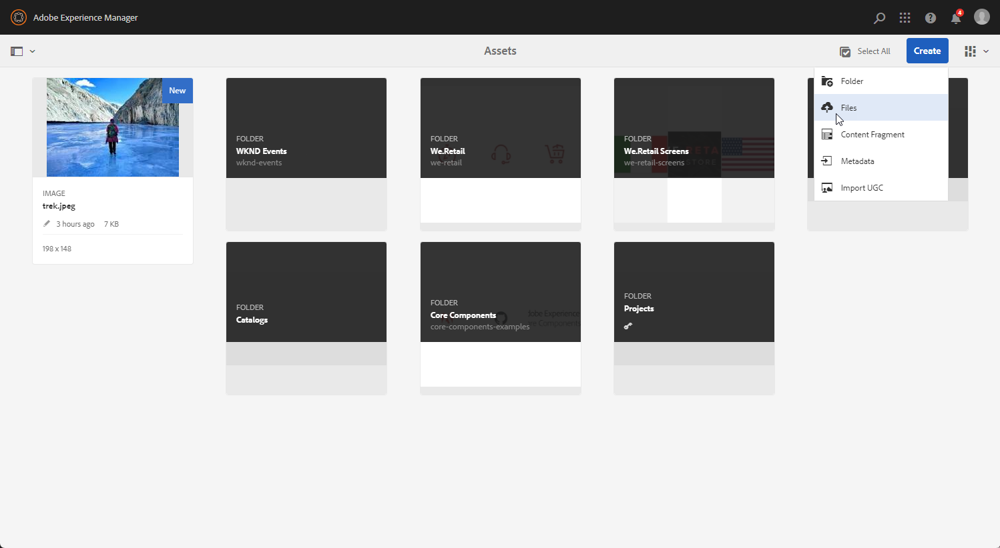

1. Cambie el nombre del recurso si es necesario y seleccione **Cargar**.

El recurso se ha cargado a la **biblioteca de Adobe Experience Manager Assets**.

**Desde Adobe Campaign:**

1. En Adobe Campaign, para crear una entrega nueva, vaya a la pestaña **Campañas**, haga clic en **Envíos** y haga clic en el botón **Crear** situado sobre la lista de envíos existentes.

   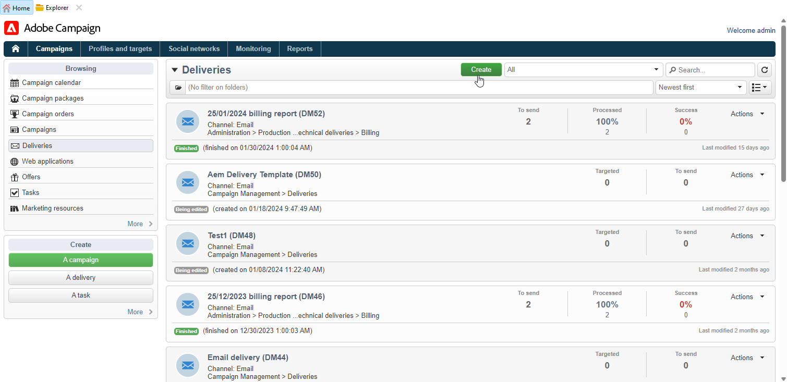

1. Seleccione una **plantilla de envíos** y asigne un nombre a la entrega.

1. Defina y personalice el contenido del mensaje. [Más información](../send/email.md)

1. Para usar tu **biblioteca Adobe Experience Manager Assets**, accede a **[!UICONTROL Properties]** de tu entrega de AEM y selecciona la pestaña **[!UICONTROL Advanced]**.

   Elija su **cuenta de AEM** y habilite la opción **[!UICONTROL Use above AEM instance as shared asset library]**.

   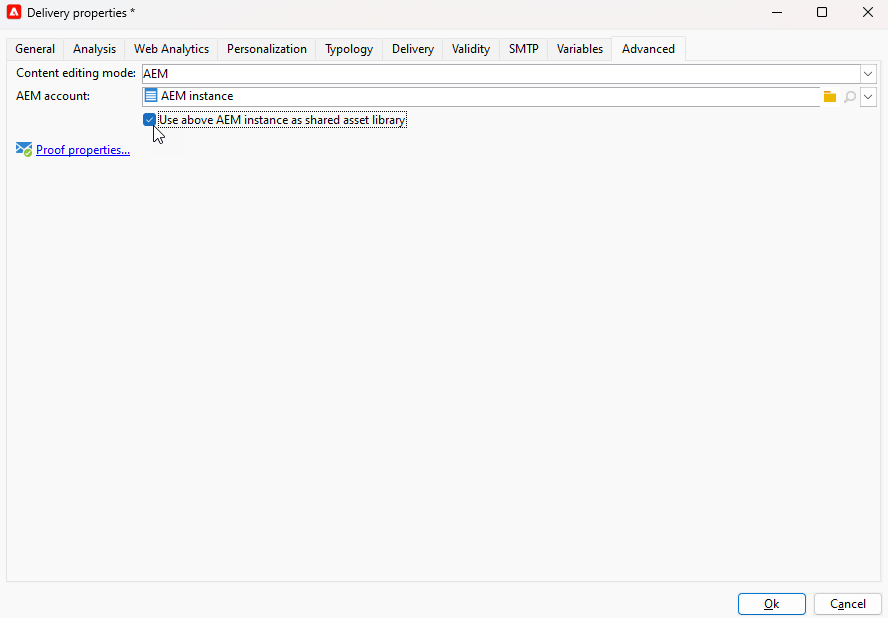

1. Desde el icono **Image**, accede al menú **[!UICONTROL Select a shared asset]**.

   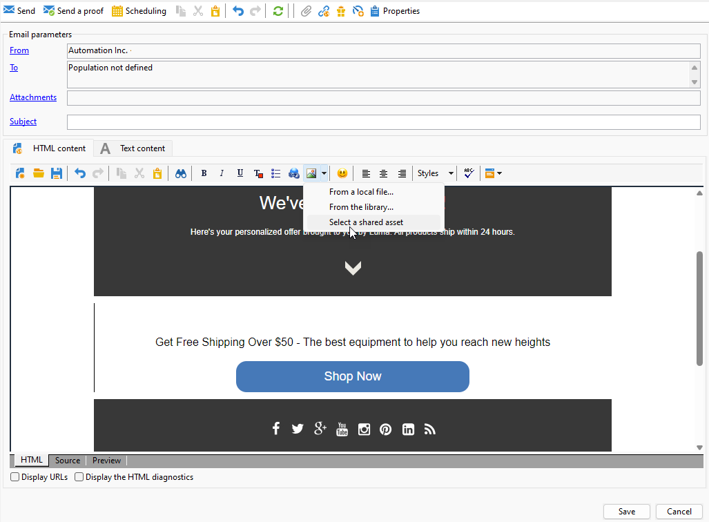

1. En la ventana de selección, selecciona una imagen de tu **biblioteca Adobe Experience Manager Assets** y, a continuación, **selecciona**.

   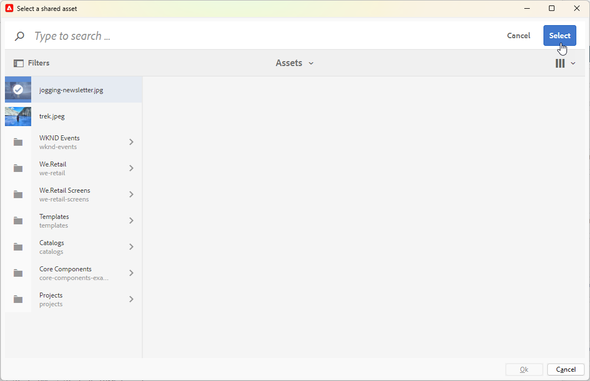

El recurso se ha cargado a su envío de correo electrónico. Ahora puede especificar la audiencia de destino, confirmar la entrega y continuar enviándolo.
