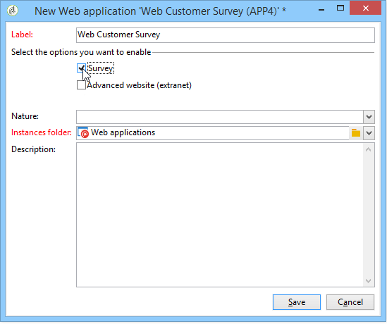

# Introducción a las aplicaciones web{#about-web-applications}

>[!NOTE]
>
>Para los casos de uso más comunes, cree sus páginas de destino en la interfaz de usuario de Campaign Web, donde podrá diseñarlas y publicarlas fácilmente. Las páginas de aterrizaje creadas en la consola del cliente, tal como se describe en esta sección, ofrecen más configuraciones y cubren casos de uso más avanzados.
>
>[Obtenga más información acerca de las páginas de destino en la interfaz de usuario web de Campaign](https://experienceleague.adobe.com/en/docs/campaign-web/v8/landing-pages/get-started-lp){target="_blank"}

Adobe Campaign permite crear y publicar aplicaciones web dinámicas e interactivas con información de la base de datos y contenido adaptado a los derechos del usuario conectado.

Puede crear páginas, como un formulario de edición en una extranet, o formularios de notificación en los que se incluya la información de la base de datos con tablas, gráficos, formularios de entrada, etc. Esta funcionalidad permite diseñar y enviar páginas web en las que los usuarios pueden buscar o introducir información.

Puede ser un formulario de suscripción que contenga datos previamente cargados con información contenida en la base de datos de Adobe Campaign, como se muestra a continuación:

En este capítulo se ofrece información general sobre cómo administrar aplicaciones web.

>[!NOTE]
>
>Consulte la [lista de comprobación de seguridad y privacidad](https://helpx.adobe.com/es/campaign/kb/acc-security.html) para obtener información sobre cómo optimizar la seguridad de las aplicaciones web.

>[!CAUTION]
>
>Por razones de privacidad, recomendamos utilizar HTTPS para todos los recursos externos.

## Alcance de la aplicación web {#web-application-scope}

Las aplicaciones web de Adobe Campaign proporcionan acceso a las siguientes funcionalidades:

* Creación de formularios de múltiples páginas. Para obtener más información, consulte [esta página](about-web-forms.md).
* Gestión de encuestas multilingües con una herramienta de traducción integrada. Para obtener más información, consulte [esta página](translating-a-web-application.md).
* Interfaz de administración de páginas gráficas, diseño de página de varias columnas. Para obtener más información, consulte [esta página](designing-a-web-application.md).
* Renderización de la personalización y la posición del campo. Para obtener más información, consulte [esta página](editing-content.md#adding-personalization-content).
* Visualización condicional de los campos de encuesta según las respuestas. Para obtener más información, consulte [esta página](form-rendering.md#defining-fields-conditional-display).
* Visualización aleatoria de preguntas. Para obtener más información, consulte esta [página](https://experienceleague.adobe.com/en/docs/campaign/campaign-v8/content/surveys/building-a-survey#adding-questions){target="_blank"} (documentación de Campaign v8).
* Visualización condicional de la página. Para obtener más información, consulte [esta página](defining-web-forms-page-sequencing.md#conditional-page-display).
* La información se comprueba antes de la validación según el tipo de datos esperado (número, dirección de correo electrónico, fecha, etc.) y los campos obligatorios. Para obtener más información, consulte esta [página](form-rendering.md#defining-control-settings).
* Invitaciones o notificaciones por correo electrónico. Para obtener más información, consulte [esta página](publishing-a-web-form.md#delivering-a-form-via-email).
* Personalización de mensajes de error y de fin. Para obtener más información, consulte [esta página](defining-web-forms-properties.md#setting-up-an-error-page).
* Uso de imágenes, vídeos, vínculos de hipertexto, captcha, etc. Para obtener más información, consulte esta [página](editing-content.md).
* Seguimiento de las respuestas en tiempo real. Para obtener más información, consulte esta [página](https://experienceleague.adobe.com/en/docs/campaign/campaign-v8/content/surveys/publish-track-and-use-collected-data#response-tracking){target="_blank"} (documentación de Campaign v8).

El módulo opcional de creación **Survey** ofrece las siguientes funcionalidades adicionales:

* Extensión dinámica de la base de datos: creación de respuestas no incluidas en la plantilla de datos inicial. Para obtener más información, consulte esta [página](https://experienceleague.adobe.com/en/docs/campaign/campaign-v8/content/surveys/managing-answers#storing-collected-answers){target="_blank"} (documentación de Campaign v8).
* Generación de informes específicos. Para obtener más información, consulte esta [página](https://experienceleague.adobe.com/en/docs/campaign/campaign-v8/content/surveys/publish-track-and-use-collected-data#reports-on-surveys){target="_blank"} (documentación de Campaign v8).

En comparación con las aplicaciones web, las encuestas tienen una interfaz gráfica simplificada con un número reducido de controles de edición.

>[!NOTE]
>
>Las encuestas se detallan en [esta sección](https://experienceleague.adobe.com/en/docs/campaign/campaign-v8/content/surveys/about-surveys){target="_blank"} (documentación de Campaign v8).
>
>Las funcionalidades generales de los formularios web en Adobe Campaign se especifican en [esta sección](about-web-forms.md).

## Implementación de aplicación web {#web-application-implementation}

Para crear y publicar una aplicación web, debe:

1. Crear el contenido (campos, listas, tablas, gráficos, etc.).

   También puede ver la sección que muestra los campos disponibles para los formularios; todos estos campos también están disponibles para las aplicaciones web. Esta información está disponible en [esta página](adding-fields-to-a-web-form.md).

1. Si es necesario, puede añadir pasos de precarga, pruebas y almacenamiento, además de configurar el sistema de control de acceso (principalmente en el marco de una publicación en extranet).
1. Publicación de la aplicación web para que esté disponible en una extranet o en Adobe Campaign.

## Configuración inicial de la aplicación web {#web-application-initial-configuration}

La aplicación web se crea mediante el vínculo **[!UICONTROL Web Applications]** en el entorno **[!UICONTROL Campaigns]** y en el entorno **[!UICONTROL Profiles and targets]**.

Las aplicaciones web se almacenan en el nodo **[!UICONTROL Resources > Online > Web Applications]** del directorio de Adobe Campaign. Las configuraciones se desglosan en las siguientes carpetas:

* **[!UICONTROL Administration > Configuration > Form renderings]**: contiene las plantillas de renderización para la visualización del formulario web (aplicaciones y encuestas). La plantilla permite generar el formulario. También se utiliza una hoja de estilos CSS. Esta hoja de estilos se puede cargar a nivel de la plantilla. Para obtener más información, consulte [esta página](form-rendering.md#selecting-the-form-rendering-template).
* **[!UICONTROL Resources > Templates > Web application templates]**: contiene plantillas de formulario. Para crear un formulario o una aplicación web, se debe comenzar desde una plantilla.

## Plantillas de aplicación web {#web-application-templates}

De manera predeterminada, Adobe Campaign proporciona una plantilla por cada aplicación web disponible.

>[!NOTE]
>
>Puede convertir una aplicación web existente en una plantilla. Para ello, seleccione el formulario y haga clic en el botón derecho. Seleccione **[!UICONTROL Actions > Save as template...]**.

Puede crear más plantillas a través del nodo **[!UICONTROL Resources > Templates > Web Application templates]** del directorio de Adobe Campaign.

El asistente de creación le permite seleccionar las opciones que desee habilitar, como se muestra a continuación.

>[!CAUTION]
>
>Las aplicaciones disponibles dependen de sus opciones y módulos. Compruebe el acuerdo de licencia.
