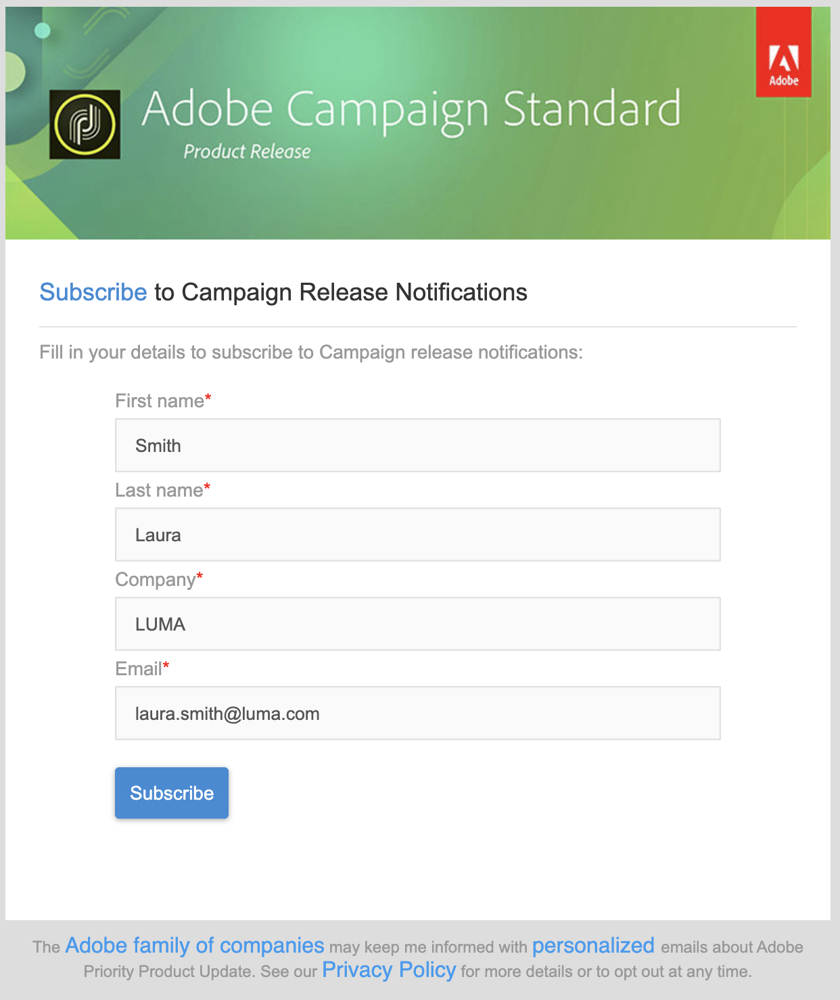

# Introducción a las aplicaciones web y los formularios web{#gs-ac-web}

>[!NOTE]
>
>Para los casos de uso más comunes, cree sus páginas de destino en la interfaz de usuario de Campaign Web, donde podrá diseñarlas y publicarlas fácilmente. Las páginas de aterrizaje creadas en la consola del cliente, tal como se describe en esta sección, ofrecen más configuraciones y cubren casos de uso más avanzados.
>
>[Obtenga más información acerca de las páginas de destino en la interfaz de usuario web de Campaign](https://experienceleague.adobe.com/en/docs/campaign-web/v8/landing-pages/get-started-lp){target="_blank"}

Adobe Campaign incluye un módulo gráfico para definir y publicar **formularios web** a fin de crear páginas con campos de entrada y selección, que pueden incluir datos de la base de datos. Esto le permite diseñar y publicar páginas web a las que los usuarios pueden acceder para ver o introducir información.

Aprenda a crear y publicar formularios web en [esta sección](web/about-web-forms.md)

Adobe Campaign también le permite crear y publicar **aplicaciones web** dinámicas e interactivas con datos de la base de datos y contenido adaptado a los derechos del usuario conectado.

Puede crear páginas, como un formulario de edición en una extranet, o formularios de notificación en los que se incluya la información de la base de datos con tablas, gráficos, formularios de entrada, etc. Esta funcionalidad permite diseñar y enviar páginas web en las que los usuarios pueden buscar o introducir información.

Aprenda a crear y publicar aplicaciones web en [esta sección](web/about-web-applications.md)
