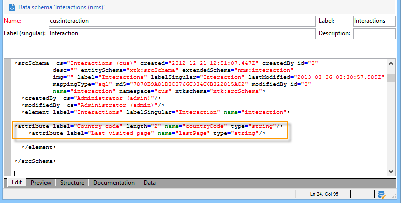
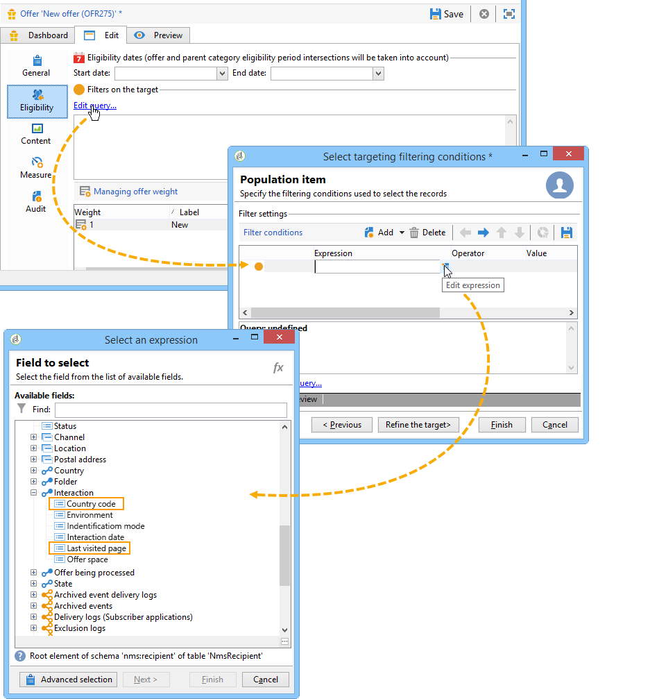

# Ejemplo de extensión{#extension-example}

En el caso de un contacto entrante (centro de llamadas o sitio web), las ofertas más relevantes se sugieren a un contacto determinado mediante un conjunto de reglas de elegibilidad. Para mejorar los criterios de idoneidad de sus ofertas, amplíe el esquema **nms:interaction**.

* Para añadir un un nuevo contexto de interacción, amplíe el esquema **nms:interaction** y cree tantos elementos **atributo** como sea necesario en el esquema.

  En el siguiente ejemplo, los criterios añadidos son el código de país y la última página visitada.

  

* A continuación, se puede utilizar los atributos creados previamente al realizar la definición de criterios de idoneidad.

  En el ejemplo siguiente, se puede crear criterios de idoneidad para mostrar una oferta en función del país del usuario o de la última página web que visitó.

  

* Al configurar las llamadas SOAP, inserte el elemento XML **context** para hacer referencia a la información contextual añadida en el esquema de interacción. Para obtener más información, consulte [Integración mediante SOAP (lado del servidor)](https://experienceleague.adobe.com/es/docs/campaign/campaign-v8/offers/inbound/interaction-integration){target="_blank"} (documentación de Campaign v8).
