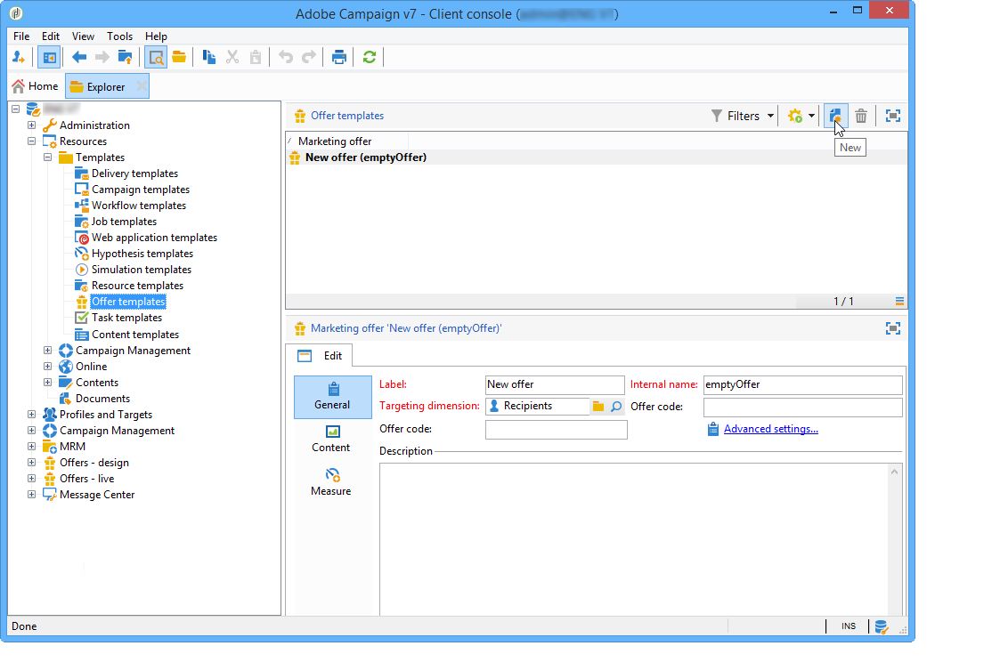
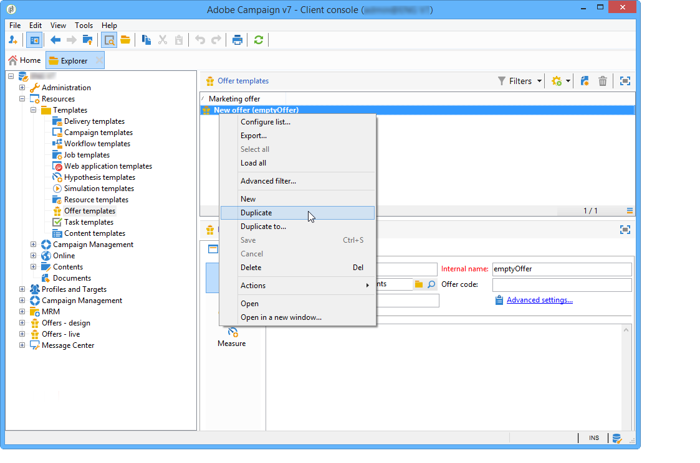
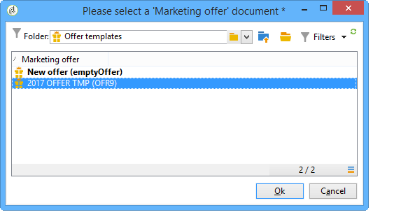

# Administración de las plantillas de oferta{#managing-offer-templates}

Las plantillas de oferta se entregan ya listas para usar en Adobe Campaign. Puede utilizarlas después de crear sus ofertas, duplicar o adaptar la configuración a sus necesidades. También puede crear sus propias plantillas. Las ofertas de plantilla se almacenan en la carpeta **Recursos** > **Plantillas** > **Plantillas de oferta**.

## Creación de una plantilla de oferta {#creating-an-offer-template}

Para crear una plantilla de oferta, siga estos pasos:

1. Vaya a **Recursos** > **Plantillas** > **Plantillas de oferta**.
1. Haga clic en el icono **Nueva**.

   

1. Configure la plantilla aplicando el mismo proceso que para una oferta normal y, a continuación, guárdela haciendo clic en **Guardar**.

## Duplicación de una plantilla existente {#duplicate-an-existing-template}

Para duplicar una plantilla de oferta (preestablecida o no), siga estos pasos:

1. Vaya a **Recursos > Plantillas > Plantillas de oferta**.
1. Con el ratón, haga clic con el botón derecho en la plantilla que desee duplicar y seleccione **Duplicado** del menú desplegable.

   

1. Si es necesario, configure los parámetros que desea ver en la plantilla y, a continuación, guarde la plantilla haciendo clic en **Guardar**.

Esta plantilla se ofrecerá ahora al crear una oferta.

