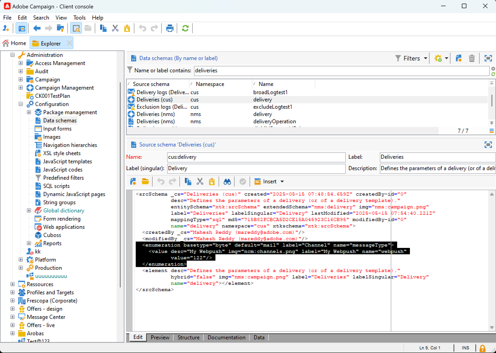
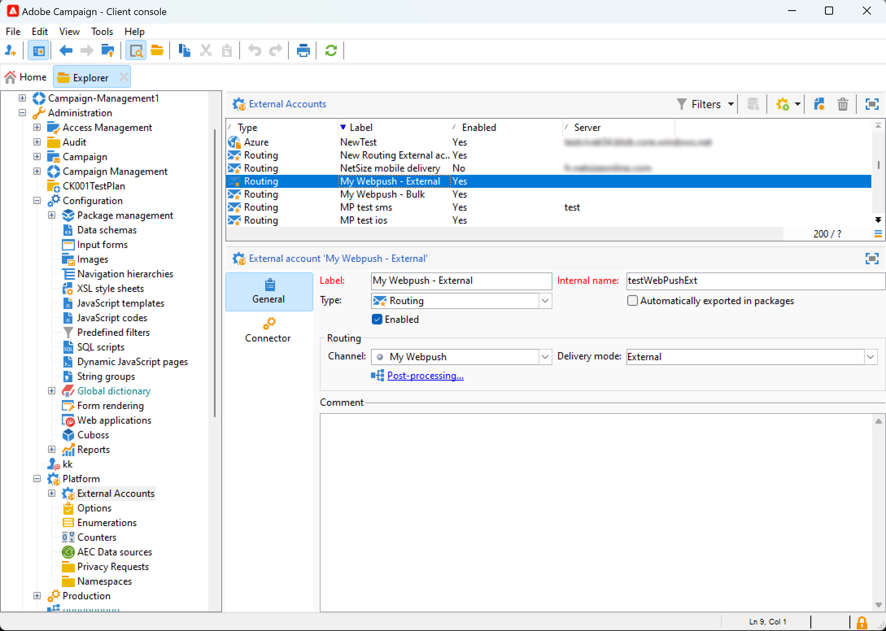
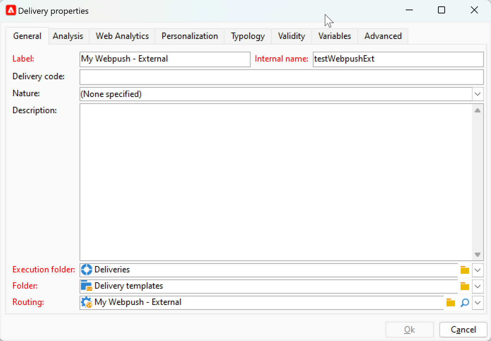
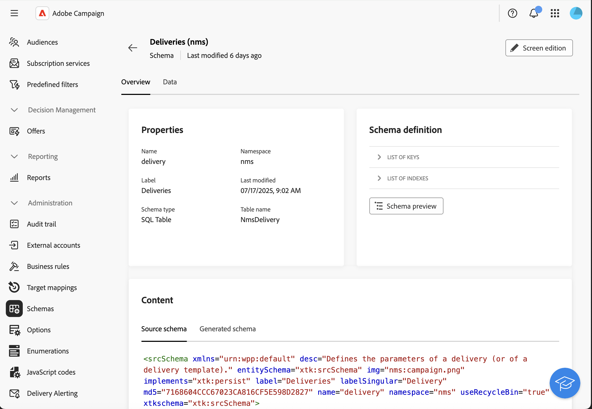
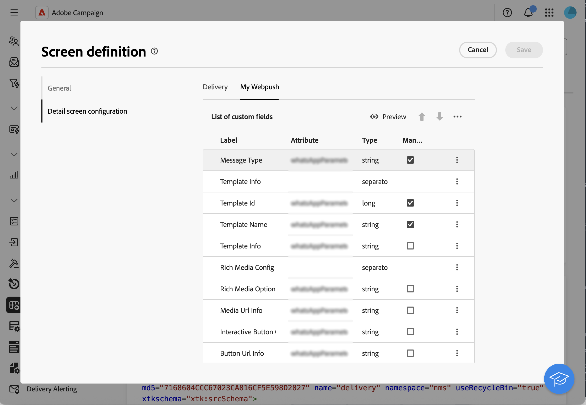

# Introducción a los canales personalizados {#gs-custom-channel}

Adobe Campaign le permite crear canales externos o API personalizados integrados con terceros. A continuación, puede organizar y ejecutar envíos basados en estos canales.

La creación y la entrega de envíos se pueden realizar tanto en la consola del cliente como en la interfaz de usuario web. Sin embargo, la configuración de canal personalizado solo se realiza en la consola del cliente.

Para obtener información sobre cómo crear y realizar una entrega basada en un canal personalizado, consulte esta [página](https://experienceleague.adobe.com/docs/campaign-web/v8/msg/gs-custom-channel.html){target="_blank"}.

Estos son los pasos para configurar un nuevo canal personalizado en la consola del cliente. Estos pasos son comunes a los canales externos y API personalizados:

1. Configure el esquema [Configure el esquema](#configure-schema)
1. Crear una nueva cuenta externa, [Crear una nueva cuenta externa](#create-ext-account)
1. Crear una nueva plantilla de envíos, [Crear una nueva plantilla de envíos](#create-template)

Los canales de API personalizados requieren una configuración adicional. [Configuración adicional de API personalizada](#api-additional)

## Configuración del esquema{#configure-schema}

En primer lugar, se debe configurar el esquema para añadir el nuevo canal a la lista de canales disponibles.

1. En el explorador de Campaign, seleccione **Administración** > **Configuración** > **Esquemas de datos**.

1. Cree una extensión de esquema para ampliar la **messageType** [enumeración](../config/enumerations.md) con el nuevo canal.

   Por ejemplo:

   ```xml
   <enumeration basetype="byte" default="mail" label="Channel" name="messageType">
   <value desc="My Webpush" img="ncm:channels.png" label="My Webpush" name="webpush"
          value="122"/>
   </enumeration>
   ```

   {zoomable="yes"}

## Cree una nueva cuenta externa{#create-ext-account}

A continuación, debe crear una nueva cuenta externa de enrutamiento.

1. En el explorador de Campaign, seleccione **Administración** > **Plataforma** > **Cuentas externas**.

1. Cree una nueva cuenta externa.

1. Seleccione el canal y cambie el modo de envío. Elija **Externo** para canales externos personalizados y **Masivo** para canales API personalizados.

   {zoomable="yes"}

## Creación de una nueva plantilla de envíos{#create-template}

Ahora, vamos a crear la nueva plantilla asociada al nuevo canal.

1. En el explorador de Campaign, seleccione **Recursos** > **Plantillas** > **Plantillas de envío**.

1. Cree una nueva plantilla.

1. Haga clic en **Propiedades** y seleccione la carpeta y el enrutamiento correctos.

   {zoomable="yes"}

El nuevo canal ya está disponible. Puede crear y ejecutar envíos basados en este canal.

## Configuración adicional de API personalizada{#api-additional}

Estos son los pasos adicionales principales para configurar canales de API personalizados.

### Ampliación del esquema{#api-additional-schema}

Desde la consola del cliente, amplíe el esquema **Delivery** con todas las propiedades adicionales necesarias para el canal personalizado.

Para obtener más información sobre la extensión de esquema, consulte esta [página](../dev/extend-schema.md).

### Configuración de la definición de pantalla personalizada{#api-additional-screen}

En la interfaz de usuario web de Campaign, configure la definición de pantalla personalizada:

1. Abra el esquema **Delivery** y haga clic en **Screen edition**.

   {zoomable="yes"}

1. Seleccione la pestaña que corresponde al canal y defina cómo se mostrarán los campos en la pantalla de contenido del envío. Para obtener más información sobre la edición en pantalla, consulte esta [página](https://experienceleague.adobe.com/docs/campaign-web/v8/conf/schemas.html#fields){target="_blank"}.

   {zoomable="yes"}

1. En la sección **Vista previa para simular contenido**, seleccione el JSP dedicado. Esto es opcional. Esto activa la previsualización en la pantalla de simulación de envío. [Configurar la vista previa](#api-additional-preview)

### Configuración de la previsualización{#api-additional-preview}

Esta configuración es opcional. Si desea activar la previsualización en la interfaz de usuario web, en la pantalla de simulación de envío debe configurar un JSSP dedicado en la consola del cliente.

Cuando hace clic en **Abrir vista previa** en la pantalla de simulación de envío de la interfaz de usuario web, se pasan los siguientes parámetros en la dirección URL:

`https://adobe.campaign.adobe.com/cus/webPushMessagePreview.jssp?deliveryId=%40ToPzTurO9aGzQxYcMArBbA%3D%3D&id=%40oF8Fi17txuLmtiOFj4OIjQ%3D%3D`

* `deliveryId`: el identificador de la entrega
* `id`: el identificador de perfil

En la consola del cliente, seleccione **Administración** > **Configuración** > **Páginas dinámicas de JavaScript** y cree un nuevo JSSP. Este es un ejemplo con los parámetros que deben recuperarse.

```html
<%@ page import="xtk:shared/nl.js"
%><%
  NL.require("/nl/core/shared/core.js")
    .require('/nl/core/jsspcontext.js')
    .require('/nl/core/shared/dataTypes.js')
    .require('/nl/core/schema.js');
    
  //response.setContentType("text/plain");
  var parameters = request.parameters;
  var deliveryId = decryptString(parameters.deliveryId);
  var oldUserContext = logonEscalation("neolane")
  
   var delivery = xtk.queryDef.create(<queryDef schema="nms:delivery" operation="getIfExists">
                                         <select>
                                           <node expr="[WebpushParameters/@richMediaOptions]" alias="@richMediaOptions"/>
                                           <node expr="[WebpushParameters/@mediaUrlInfo]" alias="@mediaUrlInfo"/>
                                           <node expr="[WebpushParameters/@WebpushMessageType]"/>
                                         </select>
                                         <where>
                                           <condition expr={"@id = " + NL.XTK.toXTKString(deliveryId)}/>
                                         </where>
                                       </queryDef>).ExecuteQuery();

  // Restore previous context
  logonWithContext(oldUserContext)
%>

<!DOCTYPE html ...
```

### Implementación técnica{#api-additional-technical}

Según el canal personalizado, deberá configurar otras partes de la aplicación, como cuentas externas, asignación de destino, código Javascript para API, etc.

