# Creación de entregas de LINE

LINE es una aplicación gratuita de mensajería instantánea, llamadas de voz y vídeo disponible en todos los sistemas operativos móviles y en PC. Puede utilizar Adobe Campaign para enviar mensajes de LINE.

[!DNL LINE] también se puede combinar con el módulo de mensajes transaccionales para enviar mensajes en tiempo real en la aplicación [!DNL LINE] instalada en los dispositivos móviles de los consumidores. Para obtener más información, consulte esta [página](https://experienceleague.adobe.com/es/docs/campaign-classic/using/transactional-messaging/configure-transactional-messaging/transactional-messaging-architecture#transactional-messaging-and-line) en la documentación de Campaign Classic v7.

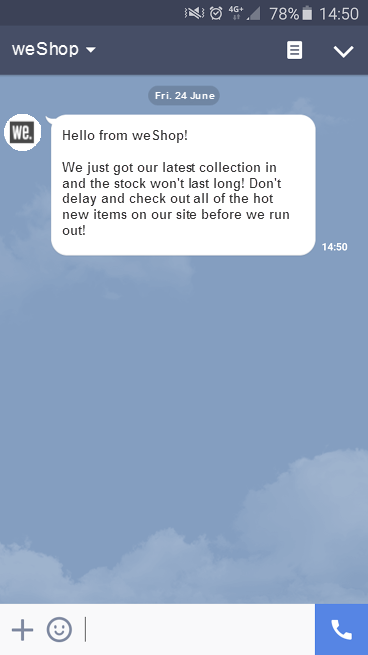

Los pasos para utilizar el canal [!DNL LINE] son los siguientes:

1. [Configuración del canal LINE](#setting-up-line-channel)
1. [Creación de un envío](#creating-the-delivery)
1. [Configuración del tipo de contenido](#defining-the-content)
1. [Monitorización de la entrega (seguimiento, cuarentena, informes, etc.)](#accessing-reports)

## Configuración del canal LINE {#setting-up-line-channel}

Antes de crear una cuenta de [!DNL LINE] y una cuenta externa, el paquete LINE debe instalarse en su instancia. Póngase en contacto con su representante de Adobe.

Primero debe crear una cuenta de [!DNL LINE] para poder vincularla a Adobe Campaign. A continuación, puede enviar mensajes a través de [!DNL LINE] a los usuarios que hayan añadido su cuenta de [!DNL LINE] en su aplicación móvil. Solamente el administrador funcional de la plataforma puede administrar las cuentas externas y la cuenta de [!DNL LINE].

Para crear y configurar una cuenta de [!DNL LINE], consulte [Documentación de desarrolladores de LINE](https://developers.line.me/).

### Creación y configuración del servicio LINE {#configure-line-service}

Para crear su servicio [!DNL LINE]:

1. En la página de inicio de Adobe Campaign Classic, seleccione la pestaña **[!UICONTROL Profiles and Targets]**.

1. En el menú de la izquierda, seleccione **[!UICONTROL Services and Subscriptions]** y haga clic en **[!UICONTROL Create]**.

   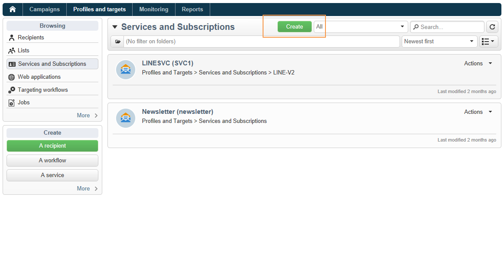

1. Añada una **[!UICONTROL Label]** y un **[!UICONTROL Internal name]** al nuevo servicio.

1. Seleccione **[!UICONTROL LINE]** en la lista desplegable **[!UICONTROL Type]**.

   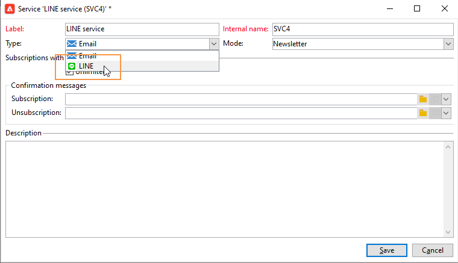

1. Haga clic **[!UICONTROL Save]**.

Para obtener más información sobre suscripciones y servicios, consulte [Administración de suscripciones](../../start/subscriptions.md).

### Configuración de la cuenta externa de LINE {#configure-line-external}

Después de crear el servicio de [!DNL LINE], debe configurar la cuenta externa de [!DNL LINE] en Adobe Campaign:

1. En la estructura de árbol **[!UICONTROL Administration]** > **[!UICONTROL Platform]**, haga clic en la pestaña **[!UICONTROL External Accounts]**.

1. Seleccione la cuenta externa de **[!UICONTROL LINE V2 routing]** integrada.

   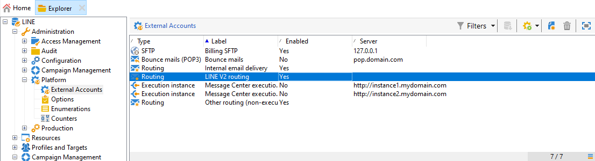

1. Haga clic en la pestaña **[!UICONTROL LINE]** de la cuenta externa para comenzar a configurarla. Rellene los campos siguientes:

   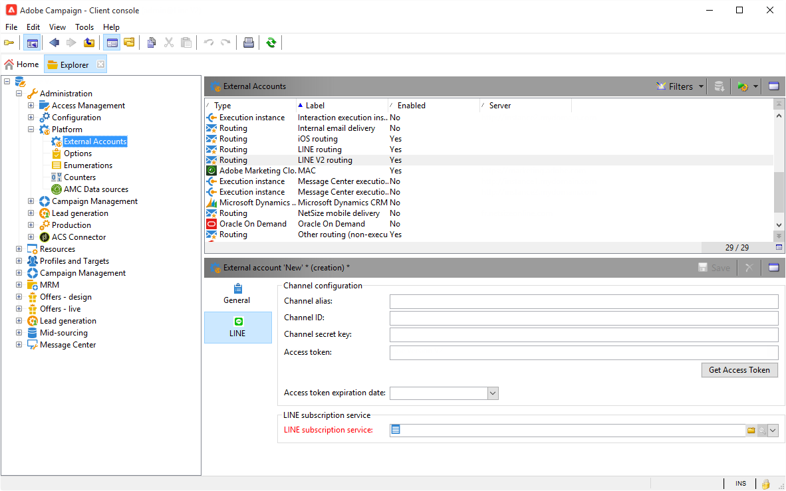

   * **[!UICONTROL Channel Alias]**: se proporciona a través de su cuenta de [!DNL LINE] en la pestaña **[!UICONTROL Channels]** > **[!UICONTROL Technical configuration]**.
   * **[!UICONTROL Channel ID]**: se proporciona a través de su cuenta de [!DNL LINE] en la pestaña **[!UICONTROL Channels]** > **[!UICONTROL Basic Information panel]**.
   * **[!UICONTROL Channel secret key]**: se proporciona a través de su cuenta de [!DNL LINE] en la pestaña **[!UICONTROL Channels]** > **[!UICONTROL Basic Information panel]**.
   * **[!UICONTROL Access token]**: se proporciona a través de su cuenta de [!DNL LINE] en el portal del desarrollador o haciendo clic en el botón **[!UICONTROL Get access token]**.
   * **[!UICONTROL Access token expiration date]**: permite especificar la fecha de caducidad del token de acceso.
   * **[!UICONTROL LINE subscription service]**: le permite especificar los servicios a los que se suscribirán los usuarios.

1. Una vez que haya terminado la configuración, haga clic en **[!UICONTROL Save]**.

1. En **[!UICONTROL Explorer]**, seleccione **[!UICONTROL Administration]** > **[!UICONTROL Production]** > **[!UICONTROL Technical workflows]** > **[!UICONTROL LINE workflows]** para comprobar si se han iniciado los flujos de trabajo **[!UICONTROL LINE V2 access token update (updateLineAccessToken)]** y **[!UICONTROL Delete blocked LINE users (deleteBlockedLineUsers)]**.

[!DNL LINE] ahora está configurado en Adobe Campaign; puede empezar a crear y enviar entregas de LINE a los suscriptores.

## Creación de entregas LINE {#creating-the-delivery}

>[!NOTE]
>
>Cuando realice una entrega de [!DNL LINE] a un nuevo destinatario por primera vez, debe añadir a la entrega el mensaje oficial de LINE sobre las condiciones de uso y el consentimiento. El mensaje oficial está disponible en el [siguiente enlace](https://terms.line.me/OA_privacy/).

Para crear una entrega de [!DNL LINE], debe seguir estos pasos:

1. En la pestaña **[!UICONTROL Campaigns]**, seleccione **[!UICONTROL Deliveries]** y haga clic en el botón **[!UICONTROL Create]**.

   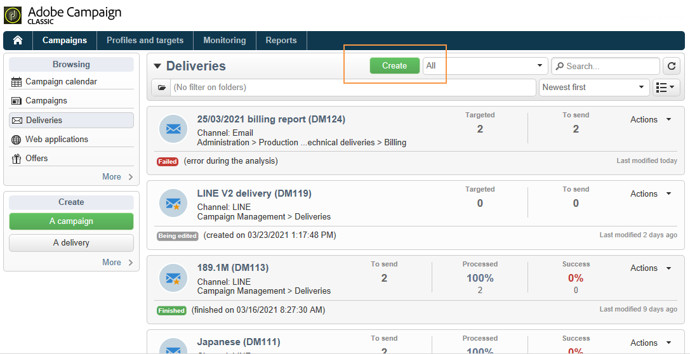

1. Seleccione la plantilla de envíos **[!UICONTROL LINE V2 delivery]**.

   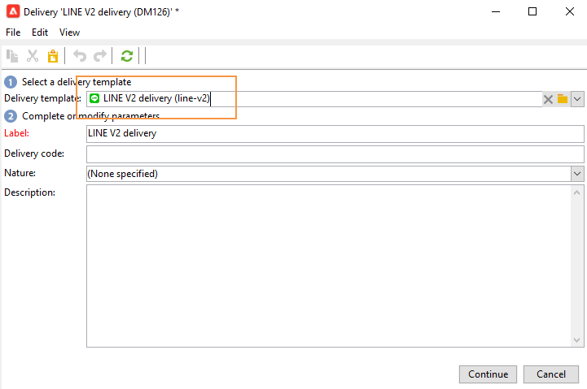

1. Identifique su envío con una **[!UICONTROL Label]**, un **[!UICONTROL Delivery code]** y una **[!UICONTROL Description]**. Para obtener más información, consulte [Crear la entrega](../../start/create-message.md#create-the-delivery).

1. Haga clic en **[!UICONTROL Continue]** para crear su entrega.

1. En el editor de entregas, seleccione **[!UICONTROL To]** para dirigirse a los destinatarios de la entrega de [!DNL LINE]. Se realizó el direccionamiento en **[!UICONTROL Visitor subscriptions (nms:visitorSub)]**.

   Para obtener más información, consulte [Trabajar con asignaciones de destino](../../audiences/target-mappings.md).

   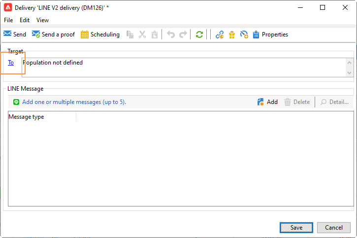

1. Haga clic en **[!UICONTROL Add]** para seleccionar su **[!UICONTROL Delivery target population]**.

   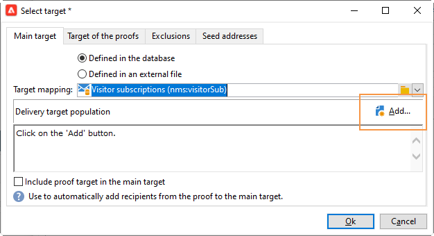

1. Seleccione si desea dirigirse a los suscriptores de [!DNL LINE] directamente o en función de su suscripción de [!DNL LINE] y haga clic en **[!UICONTROL Next]**. En este ejemplo, seleccionamos **[!UICONTROL By LINE V2 subscription]**.

1. Seleccione **[!UICONTROL Line-V2]** en la lista desplegable **[!UICONTROL Folder]** y, a continuación, su servicio de [!DNL LINE]. Haga clic en **[!UICONTROL Finish]** y luego en **[!UICONTROL Ok]** para comenzar a personalizar la entrega.

   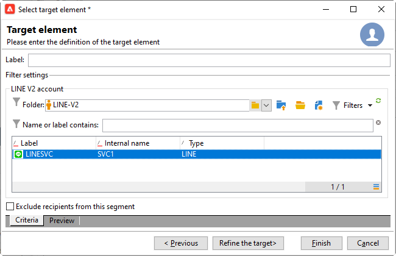

1. En el editor de envíos, haga clic en **[!UICONTROL Add]** para agregar uno o varios mensajes y seleccione **[!UICONTROL Content type]**.

   Para obtener más información sobre los diferentes **[!UICONTROL Content type]** disponibles, consulte [Definición del tipo de contenido](#defining-the-content).

   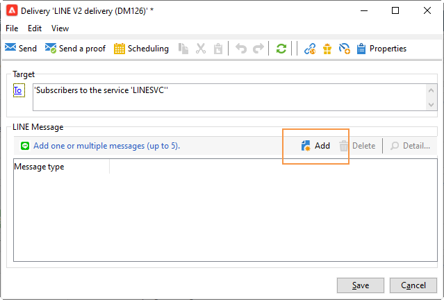

1. Cuando la entrega se haya creado y configurado correctamente, puede enviarla al objetivo definido anteriormente.

   Para obtener más información sobre cómo realizar una entrega, consulte [Envío de mensajes](../configure-and-send.md).

1. Después de enviar el mensaje, acceda al informe para medir la eficacia de su entrega.

   Para obtener más información sobre los informes de [!DNL LINE], consulte [Informes de acceso](#accessing-reports).

## Definición del tipo de contenido {#defining-the-content}

Para definir el contenido de una entrega [!DNL LINE], primero debe agregar un tipo de mensaje a la entrega. Cada entrega de [!DNL LINE] puede contener hasta 5 mensajes.

Puede elegir entre tres tipos de mensaje:

* [Mensaje de texto](#configuring-a-text-message-delivery)
* [Imagen y vínculo](#configuring-an-image-and-link-delivery)
* [Mensaje de vídeo](#configuring-a-video-message-delivery)

### Configuración de una entrega de mensaje de texto {#configuring-a-text-message-delivery}

>[!NOTE]
>
>La sintaxis `<%@ include option='NmsServer_URL' %>/webApp/APP3?id=<%=escapeUrl(cryptString(visitor.id))%>` permite incluir un vínculo a una aplicación web en un mensaje de LINE.

Una entrega de un **[!UICONTROL Text message]** de [!DNL LINE] es un mensaje enviado a los destinatarios en forma de texto.

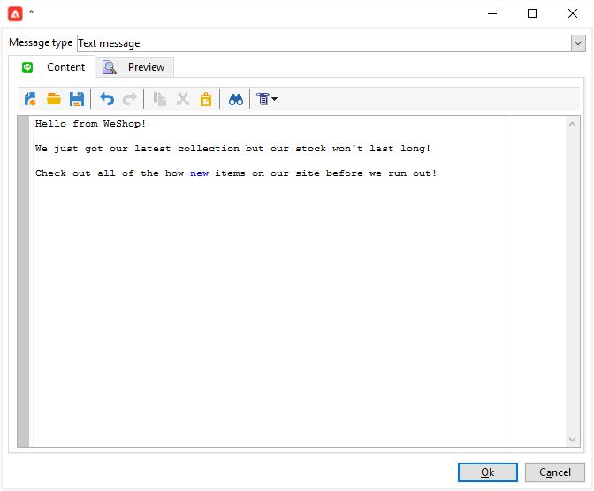

La configuración de este tipo de mensaje es similar a la configuración del **[!UICONTROL Text]** de un correo electrónico. Para obtener más información, consulte esta [página](../defining-the-email-content.md#message-content).

### Configuración de una entrega de imagen y vínculo {#configuring-an-image-and-link-delivery}

Una entrega de **[!UICONTROL Image and link]** de [!DNL LINE] es un mensaje enviado a los destinatarios en forma de imagen que puede contener una o varias URL.

Puede utilizar:

* una **[!UICONTROL Personalized image]**,

  >[!NOTE]
  >
  >Puede utilizar la variable **%SIZE%** para optimizar la visualización de la imagen según el tamaño de pantalla del dispositivo móvil del destinatario.

  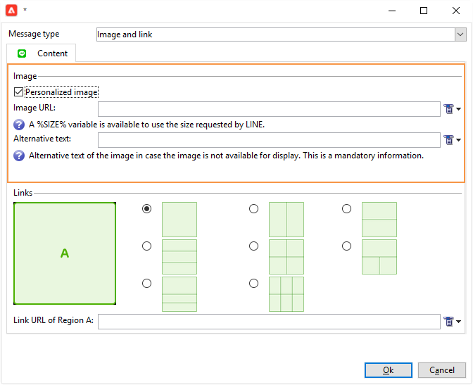

* una **[!UICONTROL Image URL]** por tamaño de pantalla del dispositivo,

  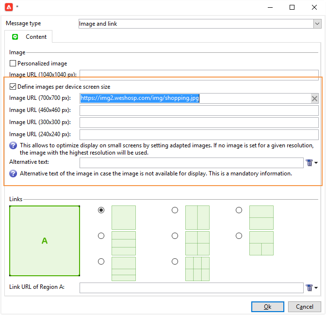

  La opción **[!UICONTROL Define images per device screen size]** le permite utilizar distintas resoluciones de imagen para optimizar la visibilidad de la entrega en dispositivos móviles. Solo se admiten imágenes con la misma altura y anchura.

  Las imágenes se pueden definir en función del tamaño de la pantalla:

  * 1040px
  * 700px
  * 460px
  * 300px
  * 240px

  >[!CAUTION]
  >
  >El tamaño de 1040 x 1040 píxeles es obligatorio para cada imagen de LINE con vínculo.

  A continuación, debe añadir el texto alternativo que aparece en el dispositivo móvil del destinatario.

* y **[!UICONTROL Links]**.

  La sección **[!UICONTROL Links]** le permite elegir entre diferentes diseños que dividen la imagen en varias regiones en las que se puede hacer clic. A continuación, puede asignar a cada una de ellas un **[!UICONTROL Link URL]** dedicado.

  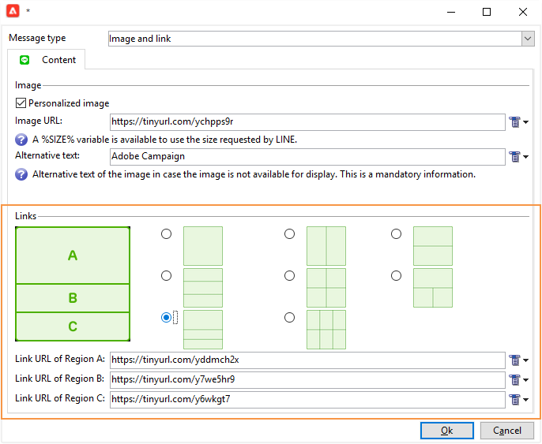

### Configuración de una entrega de mensaje de vídeo {#configuring-a-video-message-delivery}

Una entrega **[!UICONTROL Video message]** [!DNL LINE] es un mensaje enviado a los destinatarios en forma de vídeo que puede contener una dirección URL.

El campo **[!UICONTROL Preview Image URL]** permite añadir la dirección URL de una imagen de previsualización con un límite de caracteres de 1000. JPEG y PNG son compatibles con un límite de tamaño de archivo de 1 MB.

El campo **[!UICONTROL Video Image URL]** le permite añadir la dirección URL del archivo de vídeo con un límite de caracteres de 1000. Solo se admite el formato mp4 con un límite de tamaño de archivo de 200 MB.

Tenga en cuenta que los vídeos anchos o altos pueden recortarse cuando se reproducen en algunos dispositivos.

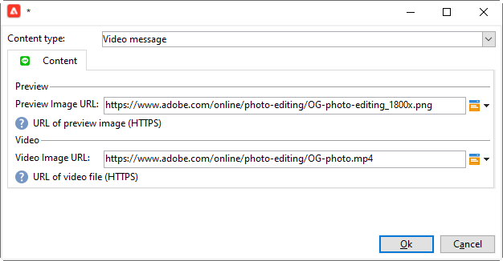

## Acceso a informes {#accessing-reports}

Después de realizar la entrega, puede ver los informes de [!DNL LINE] a través del menú **[!UICONTROL Campaign Management]** > **[!UICONTROL Deliveries]** en **[!UICONTROL Explorer]**.

>[!NOTE]
>
>Los informes de seguimiento indican la tasa de clics. [!DNL LINE] no tiene en cuenta la tasa de apertura.

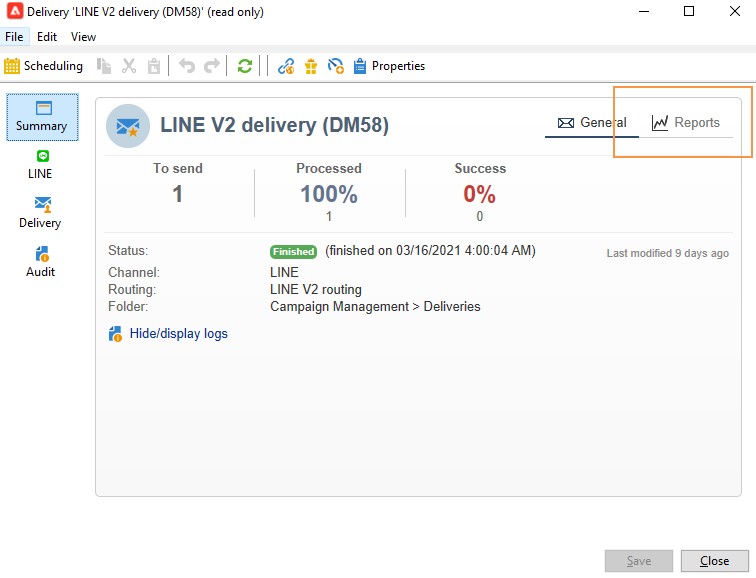

Para los informes de servicio de [!DNL LINE], acceda al menú **[!UICONTROL Profiles and Targets]** > **[!UICONTROL Services and Subscriptions]** > **[!UICONTROL LINE-V2]** desde la pestaña **[!UICONTROL Explorer]**. A continuación, haga clic en el icono **[!UICONTROL Reports]** del servicio de [!DNL LINE]

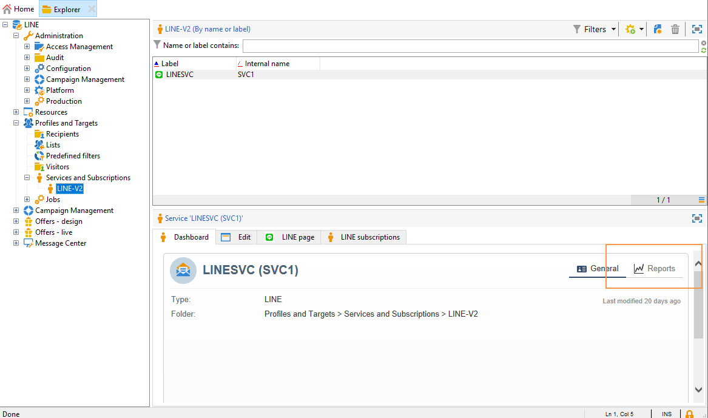

## Ejemplo: creación y entrega de un mensaje personalizado de LINE {#example--create-and-send-a-personalized-line-message}

En este ejemplo, se crea y configura un mensaje de texto y una imagen que contiene datos que se van a personalizar según el destinatario.

1. En la pestaña **[!UICONTROL Campaign]**, cree la entrega de [!DNL LINE] haciendo clic en el botón **[!UICONTROL Create]**.

   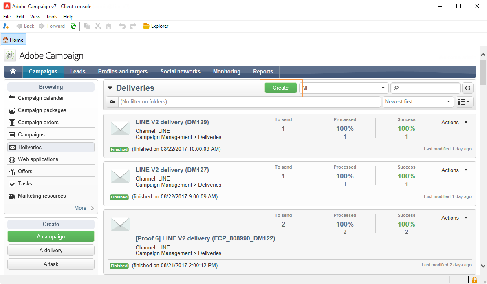

1. Seleccione la plantilla de entrega **[!UICONTROL LINE V2 delivery]** y asigne un nombre a la entrega.

   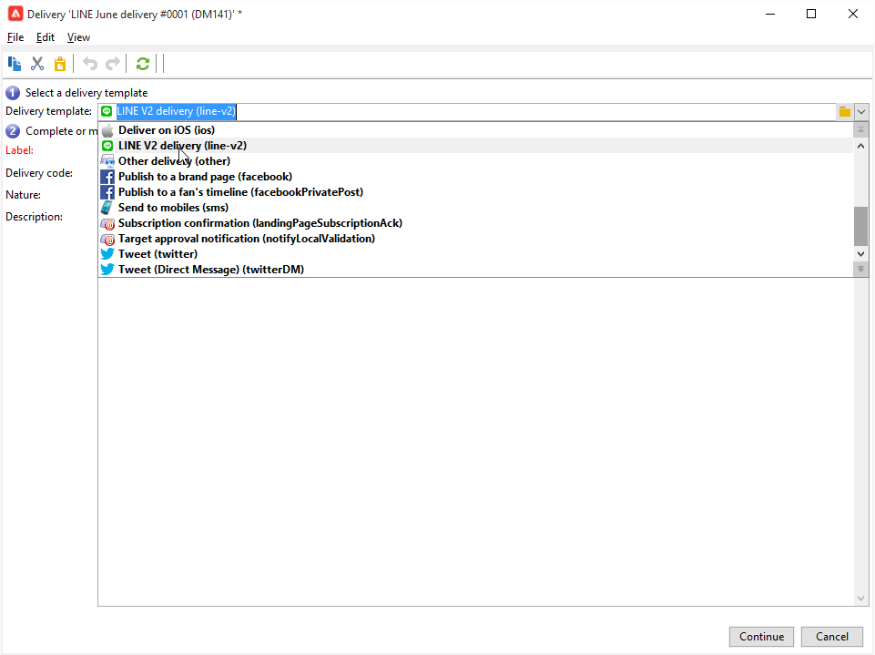

1. En la ventana de configuración de la entrega, seleccione la población objetivo.

   Para obtener más información, consulte [Identificación de poblaciones destinatarias](../../start/create-message.md#target-population).

   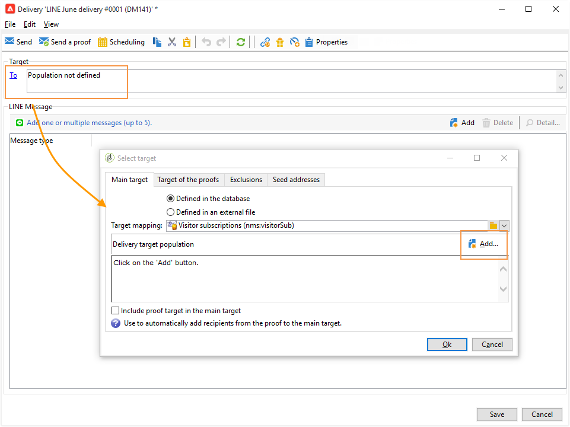

1. Haga clic en **[!UICONTROL Add]** para crear el mensaje y seleccione el **[!UICONTROL Content type]**.

   Aquí, en primer lugar, queremos crear un **[!UICONTROL Text message]**.

   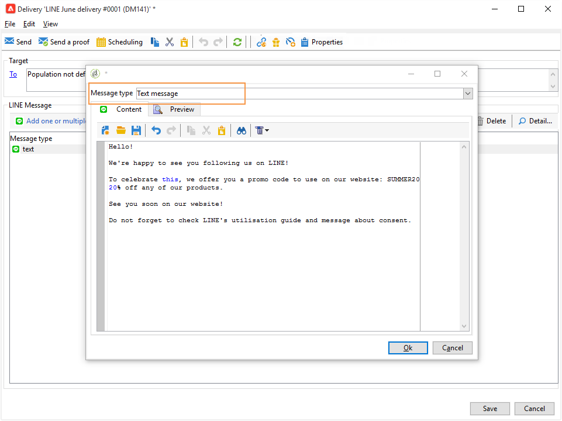

1. Sitúe el cursor en el lugar en el que desee insertar el texto personalizado, haga clic en el icono de lista desplegable y luego seleccione **[!UICONTROL Visitor]** > **[!UICONTROL First name]**.

   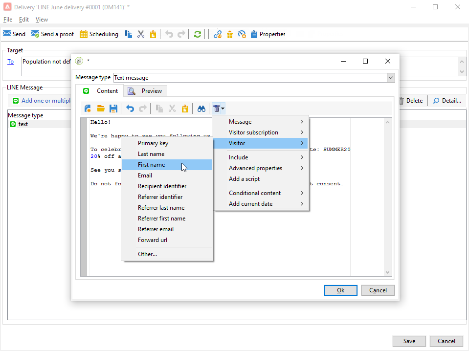

1. Siga el mismo procedimiento para añadir una imagen: seleccione **[!UICONTROL Image and links]** en la lista desplegable **[!UICONTROL Message type]**.

   Añada su **[!UICONTROL Image URL]**.

   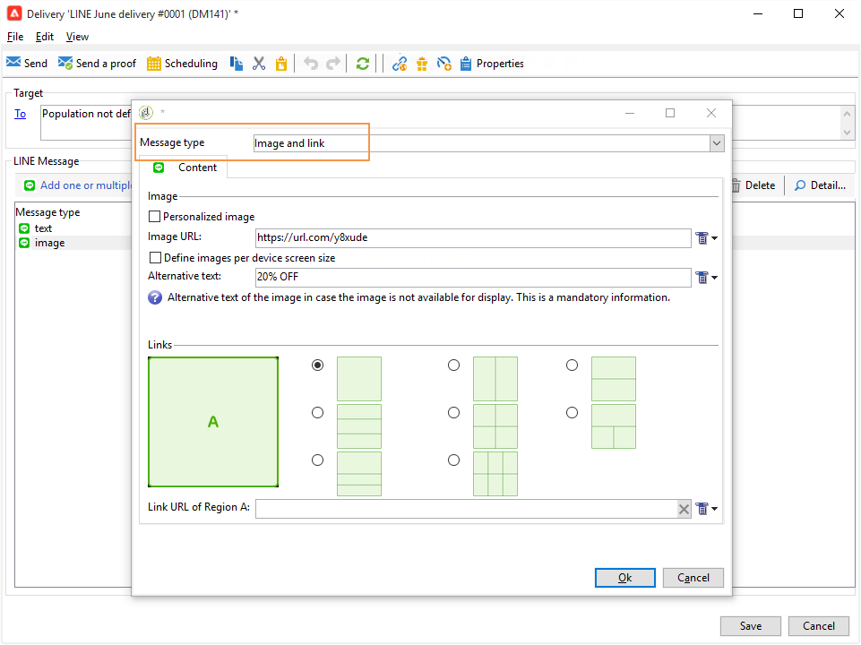

1. En la sección **[!UICONTROL Links]**, seleccione el diseño que debe dividir la imagen en varias regiones en las que se puede hacer clic.

1. Asigne una URL a cada región de la imagen.

   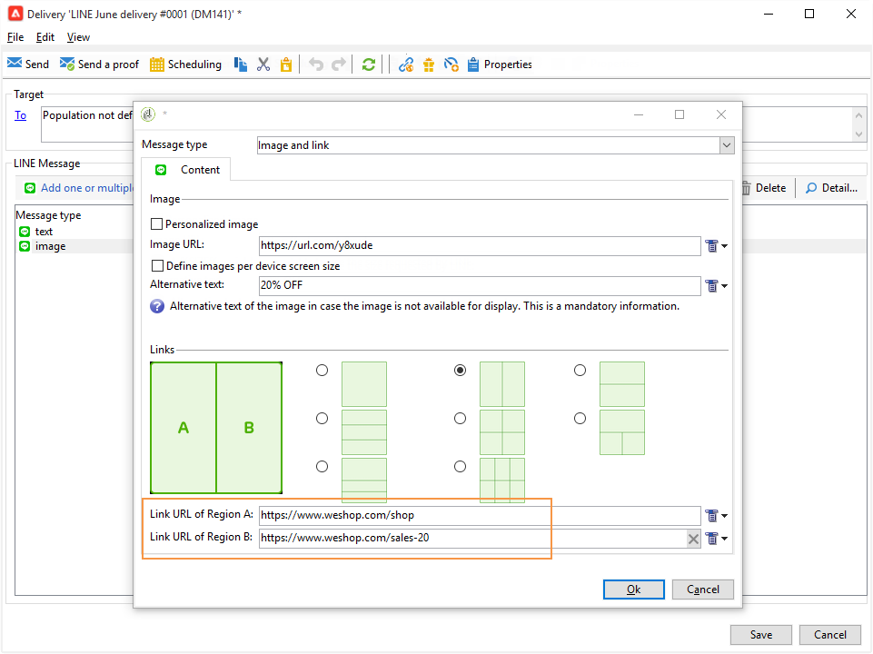

1. Guarde la entrega y haga clic en **[!UICONTROL Send]** para analizarlo y enviarlo al destinatario.

   La entrega se manda a los destinatarios.

   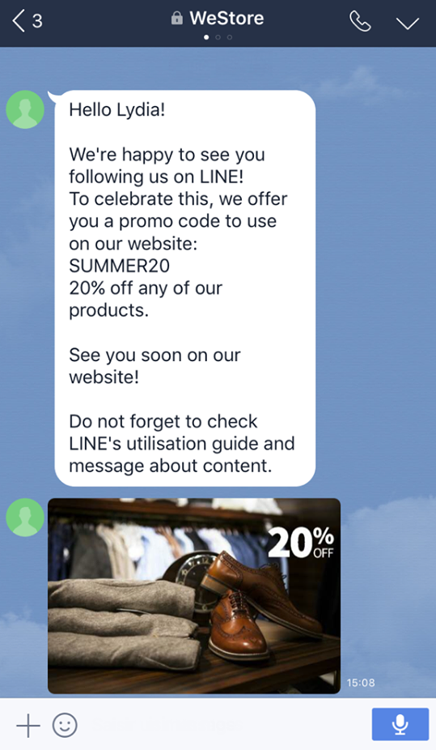

